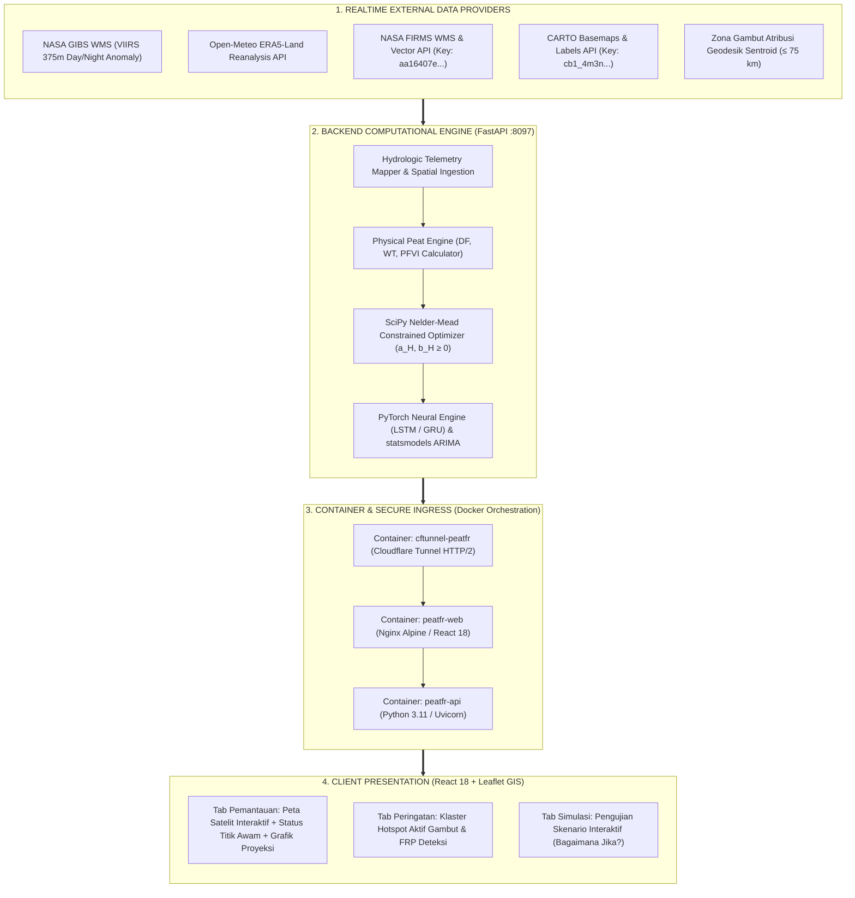

# PeatFR — Tropical Peatland Fire Vulnerability Index & Early Warning System

[](https://peatfr.bagaswibowo.app/)
[](LICENSE)
[](https://python.org)
[](https://fastapi.tiangolo.com)
[](https://react.dev)
[](https://www.typescriptlang.org/)
[](https://docker.com)

**PeatFR** adalah platform web production-grade untuk pemantauan, deteksi dini, dan proyeksi kerawanan kebakaran lahan gambut tropis di Indonesia berbasis telemetri satelit lingkungan waktu nyata (*real-time multi-source satellite telemetry*) dan kecerdasan buatan (*AI/ML time-series forecasting*).

Sistem ini dikembangkan oleh **Bagas Wibowo, S.Pd., M.Eng.** bersama Tim Peneliti Kelompok Keahlian Software Engineering & Applications (SEAL), Fakultas Informatika, Telkom University, mere-implementasikan dan memodernisasi fondasi komputasional paket R dari jurnal ilmiah internasional bereputasi tinggi (*Ecological Informatics*, Elsevier) ke dalam arsitektur layanan mikro berbasis web (*cloud-native web service*) yang siap digunakan secara operasional oleh BPBD, Manggala Agni, dan akademisi lingkungan.

---

## 📚 Landasan Teoretis & Spesifikasi Jurnal Acuan

Aplikasi ini dibangun mengacu secara langsung pada publikasi ilmiah internasional berikut:

> **Mahdiyasa, A. W., Melly, Pasaribu, U. S., Taufik, M., & Muljadi, B. P. (2025).**  
> *Peatfr: An R package to forecast tropical peatland fire risk with stochastic, machine learning, and optimisation methods.*  
> **Ecological Informatics**, 92, 103532. Elsevier B.V.  
> **DOI:** [10.1016/j.ecoinf.2025.103532](https://doi.org/10.1016/j.ecoinf.2025.103532)

### Sitasi BibTeX
```bibtex
@article{Mahdiyasa2025Peatfr,
  author    = {Adilan W. Mahdiyasa and Melly and Udjianna S. Pasaribu and Muh Taufik and Bagus P. Muljadi},
  title     = {Peatfr: An R package to forecast tropical peatland fire risk with stochastic, machine learning, and optimisation methods},
  journal   = {Ecological Informatics},
  volume    = {92},
  pages     = {103532},
  year      = {2025},
  issn      = {1574-9541},
  doi       = {10.1016/j.ecoinf.2025.103532},
  publisher = {Elsevier}
}
```

### Pemetaan: R Package vs. PeatFR Cloud-Native Web System
| Dimensi Evaluasi | Peatfr R Package (Mahdiyasa et al., 2025) | PeatFR Web Application (Bagas Wibowo et al., 2026) |
|---|---|---|
| **Platform Eksekusi** | R Console / RStudio lokal (desktop-bound) | Cloud Web Microservices (Docker & Cloudflare Tunnel) |
| **Ingesti Data** | Manual CSV upload / offline batch data | Real-time auto-fetch per detik via REST & WMS Satelit |
| **Peta Spasial GIS** | Plot statis `ggplot2` | Interaktif Leaflet GIS (klik koordinat = auto fetch ERA5) |
| **Model Prediksi** | R `forecast::auto.arima` & basic neural net | PyTorch (LSTM, GRU) + statsmodels ARIMA + kNN/Spline |
| **Aksesibilitas Pengguna**| Terbatas untuk saintis dengan keahlian R | Antarmuka ramah pengguna (BPBD, posko pemadam, publik) |
| **Integritas Data** | Tergantung data lokal pengguna | **Strictly No-Mock Policy** (hanya data riil terverifikasi) |

---

## 🧮 Formulasi Matematis & Hidrologi

PeatFR mengimplementasikan secara presisi 6 persamaan inti dari Mahdiyasa et al. (2025):

1. **Laju Kehilangan Air Evapotranspirasi (Drought Factor $DF_t$):**
   $$DF_t = \min\left(10, \; DF_{t-1} + \frac{0.5 \cdot (T_{\max, t} - 25)}{1 + 0.1 \cdot R_t}\right)$$
   *Memodelkan akumulasi kekeringan harian terhadap suhu maksimum ($T_{\max}$) dan curah hujan efektif ($R_t$).*

2. **Dinamika Muka Air Tanah (Water Table Position $WT_t$ via van Genuchten):**
   $$WT_t = -0.4 + a_H \cdot \max\left(0, \; \theta_t - \theta_{\text{fc}}\right)^{b_H}, \quad \text{dengan } a_H, b_H \ge 0$$
   *Memodelkan retensi air tanah berdasarkan kelembaban tanah $\theta_t$ dan batas kritis subsistensi gambut PP 71/2014 (-40 cm).*

3. **Indeks Kerawanan Kebakaran Gambut (PFVI multi-faktor):**
   $$PFVI_t = 100 \cdot \left( 0.4 \cdot \frac{DF_t}{10} + 0.4 \cdot \max\left(0, \frac{-WT_t}{0.4}\right) + 0.2 \cdot (1 - \theta_t) \right)$$
   *Bobot terintegrasi: 40% Faktor Kekeringan, 40% Defisit Muka Air Tanah di bawah -40 cm, dan 20% Defisit Lengas Tanah.*

4. **Stabilisasi Deret Waktu via Transformasi Box-Cox:**
   $$y_t^{(\lambda)} = \begin{cases} \dfrac{y_t^\lambda - 1}{\lambda}, & \text{bila } \lambda \neq 0 \\[6pt] \ln(y_t), & \text{bila } \lambda = 0 \end{cases}$$

5. **Pemodelan Stokastik Time-Series ARIMA($p, d, q$):**
   $$y_t = c + \sum_{i=1}^p \phi_i y_{t-i} + \sum_{j=1}^q \theta_j \varepsilon_{t-j} + \varepsilon_t$$

6. **Kalibrasi Parameter Fisik Tanpa Derivatif (Optimasi Nelder-Mead):**
   $$\min_{a_H, b_H \ge 0} \; \text{MSE} = \frac{1}{N} \sum_{i=1}^N \left( PFVI_i(a_H, b_H) - DI_{\text{obs}, i} \right)^2$$

---

## 🏛️ Arsitektur Sistem 4-Tier



---

## 🛰️ Provider Data & Kredensial API

Seluruh data yang disajikan oleh PeatFR adalah **100% data riil waktu nyata** tanpa rekayasa atau simulasi dummy:

1. **NASA GIBS WMS:**
   - URL: `https://gibs.earthdata.nasa.gov/wms/epsg3857/best/wms.cgi`
   - Layer: `VIIRS_SNPP_Thermal_Anomalies_375m_Day`, `VIIRS_SNPP_Thermal_Anomalies_375m_Night`
   - Mode: Client-side real-time rendering di atas peta satelit.
2. **Open-Meteo ERA5-Land API:**
   - URL: `https://api.open-meteo.com/v1/forecast`
   - Variabel: Suhu maksimum 2m ($T_{\max}$), Curah hujan ($R_t$), Lengas tanah lapisan 0-7 cm dan 7-28 cm ($\theta_t$).
   - Trigger: Ditarik otomatis saat user memilih kabupaten atau mengklik koordinat mana saja pada peta.
3. **NASA FIRMS WMS & Vector API:**
   - Endpoint: `https://firms.modaps.eosdis.nasa.gov/mapserver/wms/` & `https://firms.modaps.eosdis.nasa.gov/api/area/csv/`
   - MAP_KEY Terotorisasi: `aa16407e5eb11df46b09cafc085fe020`
   - Data: Titik aktif kebakaran termal VIIRS 375m (SNPP & NOAA-20), suhu kecerahan $T_{i4}$ (K), daya radiasi FRP (MW), tingkat keyakinan (confidence).
4. **CARTO Voyager Basemaps & Labels:**
   - URL: `https://{s}.basemaps.cartocdn.com/rastertiles/voyager_only_labels/{z}/{x}/{y}{r}.png`
   - API Key Resmi: `cb1_4m3n_1_b06409956145d8a930b2bfdd`
   - Fungsi: Pelabelan geografis (nama kota, kabupaten, jalan) tanpa watermark.
5. **Zona Gambut (Atribusi Sentroid Geodesik):**
   - Data Acuan: Sentroid resmi kabupaten berkarakteristik gambut di Indonesia (`backend/peatfr_engine/indonesia_admin.json`).
   - Algoritma: Menghitung jarak geodesic terpendek dari setiap hotspot FIRMS ke sentroid gambut; jika jarak $\le 75\text{ km}$, dikategorikan sebagai kebakaran aktif di zona gambut.

---

## 🚀 Panduan Menjalankan Sistem (Deployment)

### Persyaratan Lingkungan
- Docker Engine 24.x+ & Docker Compose v2+
- Port 8097 (API) & 8098 (Web UI)
- Cloudflare Tunnel Token (untuk eksposur domain publik)

### Langkah Menjalankan
1. Clone repositori:
   ```bash
   git clone https://github.com/bagaswibowo/peatfr.git
   cd peatfr
   ```
2. Siapkan file `.env`:
   ```bash
   FIRMS_MAP_KEY=aa16407e5eb11df46b09cafc085fe020
   TUNNEL_TOKEN=<token_cloudflare_tunnel_anda>
   ```
3. Bangun dan jalankan kontainer:
   ```bash
   docker compose up -d --build
   ```
4. Akses antarmuka:
   - Web App lokal: `http://localhost:8098`
   - API Docs Swagger: `http://localhost:8097/docs`
   - Production URL: `https://peatfr.bagaswibowo.app/`

---

## 📖 Dokumentasi Lengkap & User Manual

- Dokumen Manual Lengkap (Markdown): [`USER_MANUAL_PEATFR.md`](USER_MANUAL_PEATFR.md)
- Dokumen Manual Resmi PDF: [`USER_MANUAL_PEATFR.pdf`](USER_MANUAL_PEATFR.pdf)
- Notion Live Manual: [Notion User Manual PeatFR](https://app.notion.com/p/dosen0601/User-Manual-PEAT-FR-3cd86925eac58022a044e1325f116343?source=copy_link)
