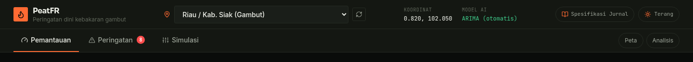
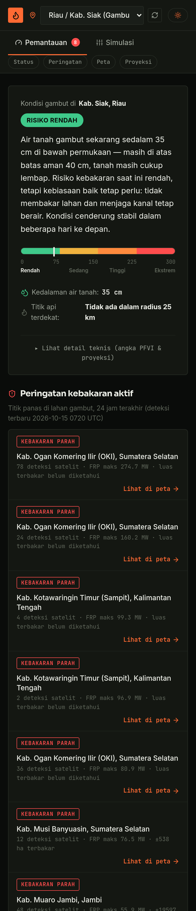
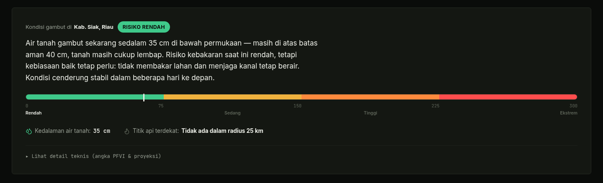
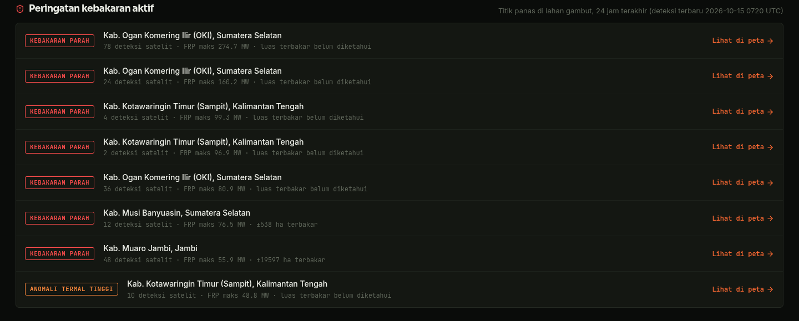
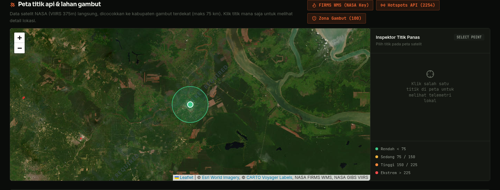
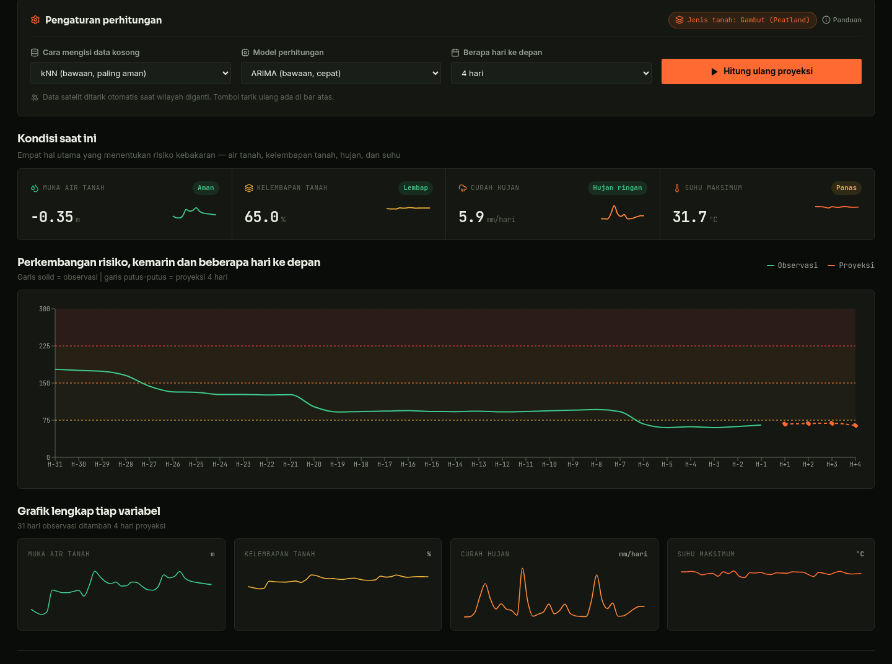
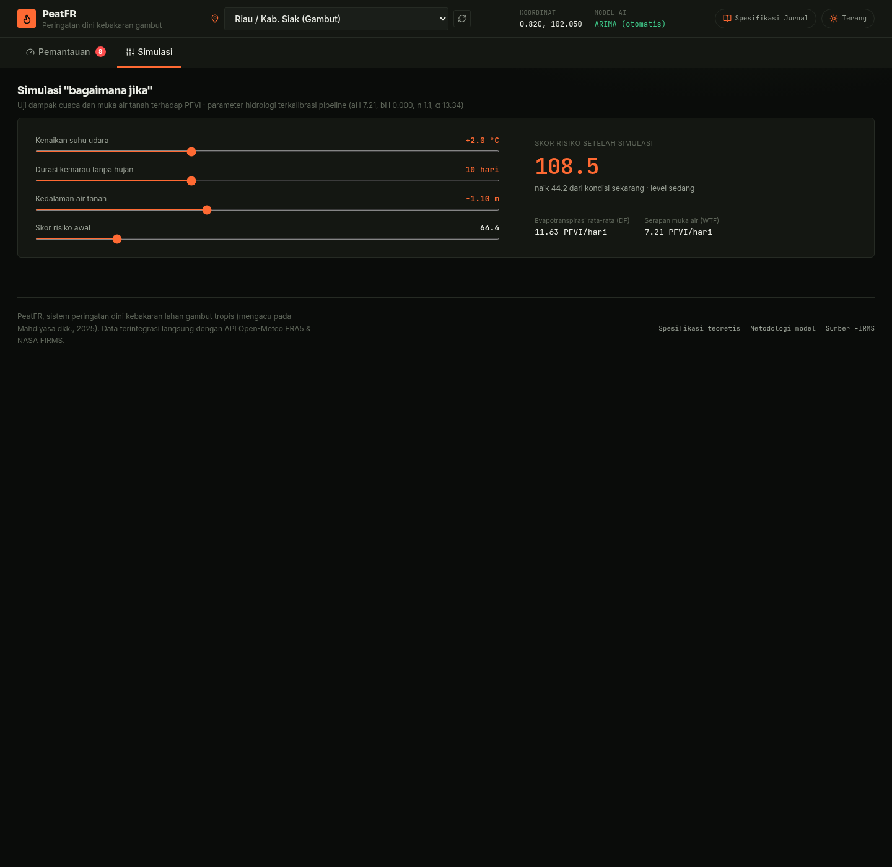

# DOKUMEN PENDOKUMENTASIAN HAK CIPTA PROGRAM KOMPUTER (DJKI KEMENKUMHAM RI)
## USER MANUAL, ARSITEKTUR, APIS, & KODE SUMBER PER FITUR
**Aplikasi PeatFR — Fire Intelligence System & Early Warning Kebakaran Lahan Gambut**

*Antarmuka PeatFR disusun sebagai dua tab operasional (Pemantauan dan Simulasi) dengan satu bilah atas global untuk pemilihan wilayah target. Seluruh angka yang ditampilkan berasal dari API publik tanpa data simulasi.*
*(Mahdiyasa et al., 2025)*

---

### Data Pendaftaran Hak Cipta (HKI)

| Parameter Hak Cipta (HKI) | Keterangan Data Resmi Pendaftaran |
|---|---|
| **Jenis Ciptaan** | **Program Komputer** (Aplikasi Web Telemetri GIS Satelit & AI Fire Forecasting) |
| **Judul Ciptaan** | **Aplikasi PeatFR — Fire Intelligence System & Early Warning Kebakaran Lahan Gambut**

*Antarmuka PeatFR disusun sebagai dua tab operasional (Pemantauan dan Simulasi) dengan satu bilah atas global untuk pemilihan wilayah target. Seluruh angka yang ditampilkan berasal dari API publik tanpa data simulasi.* |
| **Pencipta & Pemegang Hak Cipta** | **Bagas Wibowo, S.Pd., M.Eng.** & Tim Peneliti Kelompok Keahlian SEAL Telkom University |
| **Tanggal & Tempat Pertama Diumumkan** | **30 Agustus 2026** di Bandung, Jawa Barat, Republik Indonesia |
| **Teknologi Stack** | **Python 3.11** (FastAPI, PyTorch, SciPy) & **React 18** (TypeScript, Vite, Leaflet GIS) |
| **URL Akses Sistem** | https://peatfr.bagaswibowo.app/ |

---

# 1. GAMBARAN UMUM APLIKASI
PeatFR (Peatland Fire Vulnerability Index & Early Warning System) adalah platform pemantauan dan peringatan dini berbasis web yang dirancang khusus untuk memetakan dan memprediksi risiko kebakaran lahan gambut tropis di Indonesia (*Mahdiyasa et al., 2025*).

Aplikasi ini menghubungkan stasiun telemetri lingkungan realtime (Open-Meteo ERA5-Land), citra thermal satelit NASA FIRMS (VIIRS 375m & MODIS), atribusi zona gambut berbasis sentroid kabupaten gambut terdekat (is_peat), serta model kecerdasan buatan (ARIMA, LSTM, GRU) untuk memprediksi Indeks Kerawanan Kebakaran Gambut (PFVI) hingga 14 hari ke depan.

---

# 2. TUJUAN UTAMA APLIKASI
1. **Deteksi Dini Kebakaran Bawah Permukaan (Smoldering Fire):** Memantau penurunan Muka Air Tanah (TMA) hingga di bawah batas kritis PP 71/2014 (-40 cm).
2. **Penyederhanaan Akses Informasi Kebencanaan:** Menyajikan status kerawanan, daftar peringatan aktif, dan peta titik panas pada layar terpisah per tab sehingga petugas lapangan BPBD, Manggala Agni, dan warga lokal dapat membaca status tanpa membuka rumus statistik.
3. **Analisis Lanjutan & Machine Learning (Mode Pakar):** Menyediakan instrumen tuning algoritma imputasi data missing (kNN/Spline) dan model kecerdasan buatan forecasting time-series.
4. **Operasional Mitigasi Berbasis Bukti:** Menampilkan angka pendukung yang dapat diaudit (jumlah deteksi hotspot, FRP maksimum, luas terbakar, MSE optimasi) dan menandai secara eksplisit setiap nilai yang tidak tersedia, sehingga koordinasi lapangan tidak berpijak pada angka perkiraan.

---

# 3. ARSITEKTUR SISTEM & DESAIN TEKNIS (SYSTEM ARCHITECTURE)

Sistem PeatFR dirancang menggunakan arsitektur 4-tier berkinerja tinggi:

```
+-----------------------------------------------------------------------------------+
|                        1. EXTERNAL DATA PROVIDERS LAYER                           |
|  [Open-Meteo ERA5]  [NASA FIRMS WMS]  [Zona Gambut (atribusi)]  [Esri Satellite GIS]  |
+-----------------------------------------------------------------------------------+
                                         |
                                         v
+-----------------------------------------------------------------------------------+
|                        2. BACKEND COMPUTATION ENGINE (FastAPI)                    |
|  - Realtime Satellite Proxy & Hydrologic Telemetry Mapper                         |
|  - Physical Engine (PFVI Equation: DF Evapotranspiration, RF Rain, WTF Moisture)  |
|  - SciPy Nelder-Mead Parameter Optimization with Physical Bounds (a_H, b_H >= 0)  |
|  - PyTorch Deep Learning (LSTM / GRU) & Stochastic ARIMA Forecasting Engine       |
+-----------------------------------------------------------------------------------+
                                         |
                                         v
+-----------------------------------------------------------------------------------+
|                        3. CONTAINER & INFRASTRUCTURE LAYER                        |
|  [peatfr-api: Python 3.11]  <-->  [peatfr-web: Nginx]  <-->  [Cloudflare Tunnel]    |
+-----------------------------------------------------------------------------------+
                                         |
                                         v
+-----------------------------------------------------------------------------------+
|                        4. CLIENT PRESENTATION LAYER (React 18)                    |
|  - Tabbed Interface: Pemantauan (Status | Peringatan | Peta | Proyeksi) + Simulasi   |
|  - Signature Component: Peringatan Aktif (klaster hotspot zona gambut, FRP-graded) |
|  - Interactive GIS Satellite Map (Leaflet, NASA FIRMS WMS, VIIRS Hotspots)         |
+-----------------------------------------------------------------------------------+
```

### Persamaan Matematika Model Fisika PeatFR:
* **Laju Evapotranspirasi ($DF_t$):**
  $$DF_t = \frac{(300 - PFVI_{t-1}) \cdot [0.4982 \cdot e^{0.0905 T_{max} + 1.6096} - 4.268] \cdot 10^{-3}}{1 + 10.88 \cdot e^{-0.0017358 \cdot R_0}}$$
* **Faktor Curah Hujan Efektif ($RF_t$):**
  $$RF_t = \max(0, Rf_t - 5.1)$$
* **Faktor Muka Air Tanah ($WTF_t$ van Genuchten):**
  $$WTF_t = a_H - b_H \cdot (1 - \theta(v)) \cdot 300, \quad \text{dengan } \theta(v) = \left[1 + \left(\frac{v}{\alpha}\right)^n\right]^{\frac{1 - n}{n}}$$
* **Physical Boundary Constraints:**
  $$a_H \ge 0.0, \quad b_H \ge 0.0, \quad n > 1.05, \quad \alpha > 0.01$$

---

# 4. DOKUMENTASI API & SUMBER DATA (DATA SOURCES & APIS)

### A. Sumber Data Satelit Eksternal

| Provider & Dataset | Endpoint / Service URL | Variabel & Penggunaan |
|---|---|---|
| **Open-Meteo ERA5-Land** | `https://api.open-meteo.com/v1/forecast` | Suhu max 2m, Soil moisture (0-7cm, 7-28cm), Presipitasi harian |
| **NASA FIRMS WMS** | `https://firms.modaps.eosdis.nasa.gov/mapserver/wms/` | Layer thermal VIIRS 24j & MODIS 24j dengan MAP_KEY terotorisasi |
| **NASA FIRMS Vector API** | `https://firms.modaps.eosdis.nasa.gov/api/country/` | Titik hotspot VIIRS 375m, brightness T_i4 (K), daya FRP (MW) |
| **Zona Gambut (Atribusi FIRMS)** | NASA FIRMS VIIRS 375m + sentroid `peatfr_engine/indonesia_admin.json` | Deteksi hotspot aktif yang diatribusikan ke kabupaten gambut terdekat (radius <= 75 km); menggantikan GFW Vector Service yang kini mewajibkan API key berbayar (HTTP 403) |
| **NASA GIBS WMS** | `https://gibs.earthdata.nasa.gov/wms/epsg3857/` | Citra thermal anomalies VIIRS SNPP 375m Pass Siang & Malam |

### B. Spesifikasi Internal REST API (FastAPI Engine)

| HTTP Method & Route | Fungsi & Deskripsi Operasional |
|---|---|
| `GET /api/v1/realtime-peatland-data` | Mengambil telemetri ERA5-Land Open-Meteo, kalkulasi TMA & FWI OWM. |
| `POST /api/v1/pipeline/auto` | Menjalankan imputasi data missing, forecasting AI, Nelder-Mead opt, & simulasi PFVI. |
| `GET /api/v1/fire-intelligence/firms-hotspots` | Mengambil vector hotspot thermal NASA FIRMS terotorisasi. |
| `GET /api/v1/fire-intelligence/severe-alerts` | Klaster kebakaran gambut parah (grid ~16 km) hasil derivasi langsung dari hotspot NASA FIRMS, dinilai dari FRP maksimum & jumlah deteksi. |
| `GET /api/v1/fire-intelligence/gfw-peatland-fires` | Deteksi hotspot pada zona gambut (skema field GFW dipertahankan, sumber data live NASA FIRMS + atribusi sentroid kabupaten). |
| `GET /api/v1/fire-intelligence/fwi` | Fire Weather Index (OpenWeatherMap bila API key tersedia, jika tidak memakai engine meteorologi internal). |
| `GET /api/v1/indonesia/regions` | Hirarki wilayah provinsi & kabupaten gambut/mineral di Indonesia. |

---

# 5. PANDUAN PETUNJUK FITUR-DEMI-FITUR & KODE SUMBER TERHUBUNG

Aplikasi disusun sebagai dua tab operasional dengan satu bilah atas global. Tab **Pemantauan** memuat
seluruh alur pemantauan (status, peringatan, peta, proyeksi) dan menyediakan chip navigasi bagian agar
pengguna tidak perlu menggulir panjang; tab **Simulasi** memuat simulator skenario. Setiap fitur di bawah
ini memuat deskripsi, tangkapan layar mode terang, langkah penggunaan, dan daftar kode sumber terkait.

| Fitur | Layar / Komponen | Berkas Sumber Utama |
|---|---|---|
| 1. Bilah Atas & Pemilih Wilayah Global | Kedua tab | `Header.tsx` |
| 2. Status Risiko & Skala PFVI (Bahasa Awam) | Tab Pemantauan (bagian Status) | `HeroStatus.tsx`, `pfviStatus.ts` |
| 3. Peringatan Aktif Klaster Hotspot | Tab Pemantauan (bagian Peringatan) | `ActiveAlerts.tsx` |
| 4. Peta Titik Panas & Inspektor | Tab Pemantauan (bagian Peta) | `PeatlandMap.tsx` |
| 5. Konfigurasi Model & Grafik Proyeksi | Tab Pemantauan (bagian Proyeksi) | `PipelineControls.tsx`, `ForecastCharts.tsx` |
| 6. Simulasi Skenario | Tab Simulasi | `ScenarioSimulator.tsx` |
| 7. Backend API & Telemetri Realtime | FastAPI :8097 | `main.py` |
| 8. Physical Engine & Optimasi Nelder-Mead | FastAPI :8097 | `pfvi.py` |
| 9. Multi-Source Fire Intelligence Proxy | FastAPI :8097 | `fire_intelligence.py` |
| 10. Shell Aplikasi (Tab Router & State Global) | React 18 | `App.tsx` |
| 11. Infrastruktur Deployment | Docker Compose | `docker-compose.yml` |

## FITUR 1: Bilah Atas, Pemilih Wilayah Global, & Mode Tampilan

**Deskripsi & Tujuan Fitur:** Bilah atas menyatukan identitas aplikasi, pemilih wilayah target, tombol tarik ulang telemetri, sakelar mode terang/gelap, dan tautan spesifikasi jurnal. Pemilih wilayah sengaja diletakkan di sini karena lokasi adalah state global yang memengaruhi kedua tab.



*Gambar: Bilah atas PeatFR: pemilih wilayah global, tarik ulang telemetri, mode tampilan, dan dua tab operasional.*



*Gambar: Tampilan mobile 390px: bilah atas, dua tab, dan chip navigasi bagian tetap rapi tanpa overflow horizontal.*

**Cara Menggunakan:**

1. Buka **https://peatfr.bagaswibowo.app**.
2. Pilih wilayah target dari dropdown **Provinsi / Kabupaten** di bilah atas. Kabupaten bertanda **(Gambut)** memakai konstanta retensi air gambut (FC 32%, saturasi 75%); wilayah tanpa tanda memakai konstanta tanah mineral (FC 20%, saturasi 55%).
3. Perubahan wilayah langsung memicu penarikan telemetri Open-Meteo ERA5-Land dan menjalankan ulang pipeline PFVI secara otomatis.
4. Klik ikon **panah melingkar** di kanan dropdown untuk menarik ulang telemetri tanpa mengganti wilayah.
5. Klik **Terang / Gelap** untuk berpindah tema. Pilihan tema tidak mengubah data.
6. Klik **Spesifikasi Jurnal** untuk membuka modal ringkasan metodologi (render KaTeX).

#### Kode Sumber (Source Code Listing): `frontend/src/components/Header.tsx`

```tsx
import React from 'react';
import { Flame, BookOpen, Sun, Moon, RefreshCw, MapPin } from 'lucide-react';

export interface Regency {
  id: string;
  name: string;
  lat: number;
  lon: number;
  peat: boolean;
}

export interface Province {
  id: string;
  name: string;
  lat: number;
  lon: number;
  regencies: Regency[];
}

interface HeaderProps {
  provinces: Province[];
  selectedProvince: Province | null;
  selectedRegency: Regency | null;
  model: string;
  theme: 'dark' | 'light';
  loadingRealtime: boolean;
  onSelectRegion: (prov: Province, reg: Regency) => void;
  onRefresh: () => void;
  onToggleTheme: () => void;
  onOpenPaperModal: () => void;
}

export function getRegionNameFromCoords(lat: number, lon: number): string {
  if (lon >= 95 && lon < 109) return 'Sumatra';
  if (lon >= 108 && lon < 119) return 'Kalimantan';
  if (lon >= 118 && lon < 125) return 'Sulawesi';
  if (lon >= 125 && lon < 142) return 'Papua';
  if (lon >= 105 && lon < 116 && lat < -5) return 'Jawa';
  return 'Indonesia';
}

export const Header: React.FC<HeaderProps> = ({
  provinces,
  selectedProvince,
  selectedRegency,
  model,
  theme,
  loadingRealtime,
  onSelectRegion,
  onRefresh,
  onToggleTheme,
  onOpenPaperModal
}) => {
  const modelName = model === 'arima' ? 'ARIMA (otomatis)' : model === 'lstm' ? 'LSTM (AI)' : 'GRU (AI)';

  const isCustomLocation = selectedRegency ? selectedRegency.id.startsWith('CUSTOM-') : false;

  // Region selection is global state, so it lives in the top bar and is reachable
  // from every tab instead of sitting inside the algorithm panel.
  const allRegencies: { prov: Province; reg: Regency }[] = [];
  provinces.forEach((prov) => {
    (prov.regencies || []).forEach((reg) => allRegencies.push({ prov, reg }));
  });

  const coords = selectedRegency
    ? `${selectedRegency.lat.toFixed(3)}, ${selectedRegency.lon.toFixed(3)}`
    : '-';

  return (
    <header className="border-b border-[var(--line)] bg-[var(--surface)] sticky top-0 z-40 backdrop-blur-md">
      <div className="max-w-[1440px] mx-auto px-4 lg:px-7 flex items-center justify-between h-[60px] gap-3">
        {/* Brand */}
        <div className="flex items-center gap-2.5 shrink-0">
          <div className="w-[30px] h-[30px] rounded-[var(--r-sm)] bg-[var(--accent)] flex items-center justify-center text-[#0a0c0a] flex-shrink-0">
            <Flame className="w-[17px] h-[17px] stroke-[#0a0c0a] stroke-[2.2]" />
          </div>
          <div className="hidden sm:flex flex-col leading-tight">
            <b className="font-disp font-bold text-[16px] tracking-tight text-[var(--text)]">PeatFR</b>
            <span className="text-[12px] text-[var(--text-dim)]">Peringatan dini kebakaran gambut</span>
          </div>
        </div>

        {/* Region Selector (primary control, visible on every tab) */}
        <div className="flex items-center gap-2 flex-1 min-w-0 max-w-[420px]">
          <MapPin className="w-3.5 h-3.5 text-[var(--accent)] shrink-0" />
          <select
            value={isCustomLocation ? 'CUSTOM' : (selectedRegency?.id || '')}
            onChange={(e) => {
              const selectedId = e.target.value;
              if (selectedId === 'CUSTOM') return;
              const found = allRegencies.find((item) => item.reg.id === selectedId);
              if (found) onSelectRegion(found.prov, found.reg);
            }}
            aria-label="Pilih wilayah target pemantauan"
            className="w-full min-w-0 bg-[var(--surface-2)] border border-[var(--line)] rounded-[var(--r-sm)] px-3 py-2 text-[14px] font-medium text-[var(--text)] focus:outline-none focus:border-[var(--accent)] cursor-pointer"
          >
            {isCustomLocation && <option value="CUSTOM">{selectedRegency?.name}</option>}
            {allRegencies.map(({ prov, reg }) => (
              <option key={reg.id} value={reg.id}>
                {prov.name} / {reg.name}{reg.peat ? ' (Gambut)' : ''}
              </option>
            ))}
          </select>
          <button
            type="button"
            onClick={onRefresh}
            disabled={loadingRealtime}
            title="Tarik ulang telemetri satelit"
            aria-label="Tarik ulang telemetri satelit"
            className="shrink-0 p-1.5 border border-[var(--line)] rounded-[var(--r-sm)] text-[var(--text-mute)] hover:border-[var(--accent-line)] hover:text-[var(--accent)] disabled:opacity-50 cursor-pointer"
          >
            <RefreshCw className={`w-3.5 h-3.5 ${loadingRealtime ? 'animate-spin' : ''}`} />
          </button>
        </div>

        {/* Secondary telemetry readout */}
        <div className="hidden xl:flex items-center gap-5 text-xs shrink-0">
          <div className="flex flex-col gap-0.5">
            <span className="text-[10px] uppercase tracking-wider text-[var(--text-dim)] font-mono">Koordinat</span>
            <span className="text-[12px] font-mono text-[var(--text)]">{coords}</span>
          </div>
          <div className="flex flex-col gap-0.5">
            <span className="text-[10px] uppercase tracking-wider text-[var(--text-dim)] font-mono">Model AI</span>
            <span className="text-[12px] font-mono text-[var(--ok)] font-medium">{modelName}</span>
          </div>
        </div>

        {/* Right controls */}
        <div className="flex items-center gap-2 shrink-0">
          <button
            type="button"
            onClick={onOpenPaperModal}
            className="hidden lg:flex items-center gap-1.5 px-3 py-1.5 border border-[var(--line)] rounded-full text-[11px] font-mono text-[var(--text-mute)] hover:border-[var(--accent-line)] hover:text-[var(--text)] transition-colors cursor-pointer"
          >
            <BookOpen className="w-3.5 h-3.5 text-[var(--accent)]" />
            <span>Spesifikasi Jurnal</span>
          </button>

          <button
            type="button"
            onClick={onToggleTheme}
            className="flex items-center gap-1.5 px-3 py-1.5 border border-[var(--line)] rounded-full text-[11px] font-mono text-[var(--text-mute)] hover:border-[var(--accent-line)] hover:text-[var(--text)] transition-colors cursor-pointer"
            aria-label="Ganti mode terang/gelap"
          >
            {theme === 'dark' ? (
              <>
                <Sun className="w-3.5 h-3.5 text-[var(--accent)]" />
                <span className="hidden sm:inline">Terang</span>
              </>
            ) : (
              <>
                <Moon className="w-3.5 h-3.5 text-[var(--accent)]" />
                <span className="hidden sm:inline">Gelap</span>
              </>
            )}
          </button>
        </div>
      </div>
    </header>
  );
};
```

---

## FITUR 2: Tab Pemantauan — Status Risiko & Skala PFVI (Bahasa Awam)

**Deskripsi & Tujuan Fitur:** Blok pertama tab Pemantauan menjawab pertanyaan paling mendesak bagi pengguna awam: *"apakah lahan gambut di sini berbahaya hari ini?"* — dalam bahasa sehari-hari, bukan angka statistik. Hero ini menampilkan satu paragraf penjelasan polos (kedalaman air tanah vs batas aman 40 cm PP 71/2014, kelembapan tanah, tren beberapa hari ke depan, dan aksi nyata yang bisa dilakukan warga), badge status **Rendah / Sedang / Tinggi / Ekstrem**, serta skala status empat segmen berjarum pada ambang PFVI 0/75/150/225 sebagai elemen utama. Angka teknis (skor PFVI, rentang proyeksi, muka air tanah dalam meter, kelembapan) tetap tersedia tetapi disembunyikan di balik tombol **"Lihat detail teknis"** agar layar utama tidak membingungkan.



*Gambar: Bagian Status tab Pemantauan: narasi bahasa awam, skala status PFVI berjarum, dan detail teknis tersembunyi.*

**Cara Menggunakan:**

1. Tab **Pemantauan** terbuka secara default saat aplikasi dimuat.
2. Baca badge status berwarna (**Rendah** hijau, **Sedang** kuning, **Tinggi** oranye, **Ekstrem** merah) dan paragraf penjelasan di bawahnya — paragraf ini menyebut kedalaman air tanah aktual dan apa yang bisa dilakukan warga.
3. Perhatikan **skala status** di bawah narasi: jarum hitam menunjukkan posisi skor risiko saat ini di antara ambang 0/75/150/225/300.
4. Dua fakta singkat di bawah skala menampilkan kedalaman air tanah (cm) dan jarak titik api terdekat dari lokasi terpilih.
5. Klik **"Lihat detail teknis (angka PFVI & proyeksi)"** untuk membuka angka teknis lengkap; klik lagi untuk menyembunyikan.
6. Gunakan chip **Status / Peringatan / Peta / Proyeksi** di bawah tab bar untuk melompat ke bagian lain.
7. Bila sumber data satelit tidak dapat dihubungi, aplikasi menampilkan banner merah dan menahan angka risiko kosong alih-alih menampilkan nilai perkiraan.

#### Kode Sumber (Source Code Listing): `frontend/src/utils/pfviStatus.ts`

```tsx
// Shared PFVI (Peat Fire Vulnerability Index) helpers — one source of truth
// for status thresholds, labels, and lay explanation. Status comes from the
// pipeline; everything derivable from it lives here.

export type StatusKey = 'low' | 'moderate' | 'high' | 'extreme' | 'unknown';

export const statusKey = (status: string | undefined | null): StatusKey => {
  const s = (status || '').toLowerCase();
  if (s === 'low' || s === 'moderate' || s === 'high' || s === 'extreme') return s;
  return 'unknown';
};

export const STATUS_ID: Record<StatusKey, string> = {
  low: 'Rendah',
  moderate: 'Sedang',
  high: 'Tinggi',
  extreme: 'Ekstrem',
  unknown: 'Tidak diketahui'
};

// PFVI thresholds used across the app (chart bands use the same numbers).
export const STATUS_MIN: Record<Exclude<StatusKey, 'unknown'>, number> = {
  low: 0,
  moderate: 75,
  high: 150,
  extreme: 225
};
export const STATUS_ORDER: Exclude<StatusKey, 'unknown'>[] = ['low', 'moderate', 'high', 'extreme'];

export const TREND_THRESHOLD = 10; // PFVI points over the forecast horizon

export function trendInfo(min: number, max: number): { label: string; tone: 'naik' | 'turun' | 'stabil' } {
  const delta = max - min;
  if (delta > TREND_THRESHOLD) return { label: 'cenderung NAIK', tone: 'naik' };
  if (delta < -TREND_THRESHOLD) return { label: 'cenderung TURUN', tone: 'turun' };
  return { label: 'cenderung stabil', tone: 'stabil' };
}

// PP 71/2014 critical water-table depth (40 cm below surface).
export const WT_CRITICAL_CM = 40;

// One short paragraph of plain Indonesian: what's happening + what to do.
export function layStatusParagraph(opts: {
  status: StatusKey;
  wtCm: number;
  sm: number;
  locationName?: string;
  trendLabel?: string;
}): string {
  const { status, wtCm, sm, locationName, trendLabel } = opts;
  const loc = locationName ? ` di ${locationName}` : '';
  const wtDry = wtCm > WT_CRITICAL_CM;
  const wtTxt = `Air tanah gambut sekarang sedalam ${wtCm.toFixed(0)} cm di bawah permukaan${
    wtDry ? ' — sudah melewati batas aman 40 cm (aturan PP 71/2014)' : ' — masih di atas batas aman 40 cm'
  }`;
  const smTxt = sm <= 0
    ? ''
    : sm < 45
      ? ', dan tanahnya sudah kering'
      : ', tanah masih cukup lembap';
  const trendTxt = trendLabel ? ` Kondisi ${trendLabel.toLowerCase().replace('cenderung ', 'cenderung ')} dalam beberapa hari ke depan.` : '';

  switch (status) {
    case 'extreme':
      return `${wtTxt}${smTxt}. Gambut yang mengering bisa terbakar di bawah permukaan dan menghasilkan asap tebal yang sulit dipadamkan. Yang bisa dilakukan warga: jangan membakar sampah atau membuka lahan sama sekali, tutup sekat kanal agar air tertahan, dan segera laporkan asap atau titik api apa pun ke ketua RT/RW atau Manggala Agni terdekat.${trendTxt}`;
    case 'high':
      return `${wtTxt}${smTxt}. Risiko kebakaran tinggi: gambut kering dapat menyala meski tanpa api besar di permukaan. Kurangi membuka lahan, jangan membakar apa pun, dan bantu jaga pintu sekat kanal tetap tertutup agar lahan tetap basah.${trendTxt}`;
    case 'moderate':
      return `${wtTxt}${smTxt}. Risiko sedang — tetap waspada, terutama saat cuaca panas berkepanjangan. Hindari pembakaran lahan dan laporkan jika melihat asap di area gambut${loc}.${trendTxt}`;
    case 'low':
      return `${wtTxt}${smTxt}. Risiko kebakaran saat ini rendah, tetapi kebiasaan baik tetap perlu: tidak membakar lahan dan menjaga kanal tetap berair.${trendTxt}`;
    default:
      return 'Status belum dapat ditentukan untuk lokasi ini.';
  }
}

// Badge labels for the four signal cards — computed from the actual value
// instead of hardcoded, so a critical reading never shows "Normal".
export function signalBadge(variable: 'WT' | 'SM' | 'Rf' | 'Temp', value: number): { label: string; tone: 'ok' | 'warn' | 'danger' } {
  switch (variable) {
    case 'WT': {
      const cm = Math.abs(value) * 100;
      if (cm > 80) return { label: 'Sangat kritis', tone: 'danger' };
      if (cm > WT_CRITICAL_CM) return { label: 'Melewati batas aman', tone: 'danger' };
      return { label: 'Aman', tone: 'ok' };
    }
    case 'SM':
      if (value < 30) return { label: 'Kering kritis', tone: 'danger' };
      if (value < 45) return { label: 'Kering', tone: 'warn' };
      return { label: 'Lembap', tone: 'ok' };
    case 'Rf':
      if (value < 1) return { label: 'Kering', tone: 'warn' };
      if (value <= 10) return { label: 'Hujan ringan', tone: 'ok' };
      return { label: 'Hujan deras', tone: 'ok' };
    case 'Temp':
      if (value >= 34) return { label: 'Sangat panas', tone: 'danger' };
      if (value >= 31) return { label: 'Panas', tone: 'warn' };
      return { label: 'Normal', tone: 'ok' };
  }
}

export function badgeToneClass(tone: 'ok' | 'warn' | 'danger'): string {
  switch (tone) {
    case 'danger': return 'bg-[#ff4d4d1f] text-[var(--danger)]';
    case 'warn': return 'bg-[#f0b23e1f] text-[var(--warn)]';
    default: return 'bg-[#3fc98a1f] text-[var(--ok)]';
  }
}
```

#### Kode Sumber (Source Code Listing): `frontend/src/components/HeroStatus.tsx`

```tsx
import React, { useState } from 'react';
import { Printer, Info, Droplets, Flame } from 'lucide-react';
import { statusKey, StatusKey, STATUS_ID, STATUS_MIN, STATUS_ORDER, trendInfo, WT_CRITICAL_CM, layStatusParagraph } from '../utils/pfviStatus';

interface HeroStatusProps {
  hasData?: boolean;
  pfvi: number;
  status: string;
  waterTable: number;
  soilMoisture: number;
  forecastDays: number;
  minPfvi?: number;
  maxPfvi?: number;
  locationName: string;
  nearby?: {
    status?: string;
    detection_count?: number;
    nearest_distance_km?: number | null;
  };
}

// Status scale bar: one thick segmented strip with PFVI thresholds (0/75/150/225)
// and a needle at the current value — the signature element of the hero.
const StatusScale: React.FC<{ pfvi: number; status: StatusKey }> = ({ pfvi, status }) => {
  const pct = Math.min(100, Math.max(0, (pfvi / 300) * 100));
  return (
    <div className="w-full">
      <div className="relative h-3.5 rounded-full overflow-hidden flex border border-[var(--line)]">
        <div className="h-full bg-[var(--ok)]" style={{ width: '25%' }} />
        <div className="h-full bg-[var(--warn)]" style={{ width: '25%' }} />
        <div className="h-full bg-[var(--high)]" style={{ width: '25%' }} />
        <div className="h-full bg-[var(--danger)]" style={{ width: '25%' }} />
      </div>
      {/* Needle */}
      <div className="relative h-0">
        <div
          className="absolute -top-[15px] w-[3px] h-[19px] bg-[var(--text)] rounded-sm shadow transition-all duration-700"
          style={{ left: `calc(${pct}% - 1.5px)` }}
          aria-hidden="true"
        />
      </div>
      <div className="flex justify-between font-mono text-[10.5px] text-[var(--text-dim)] mt-1.5">
        <span>0</span>
        <span>75</span>
        <span>150</span>
        <span>225</span>
        <span>300</span>
      </div>
      <div className="flex justify-between text-[10.5px] font-semibold mt-0.5">
        {STATUS_ORDER.map((k) => (
          <span
            key={k}
            className={k === status ? 'text-[var(--text)]' : 'text-[var(--text-dim)]'}
            style={{ width: '25%', textAlign: k === 'low' ? 'left' : k === 'extreme' ? 'right' : 'center' }}
          >
            {STATUS_ID[k]}
          </span>
        ))}
      </div>
    </div>
  );
};

export const HeroStatus: React.FC<HeroStatusProps> = ({
  hasData = true,
  pfvi,
  status,
  waterTable,
  soilMoisture,
  forecastDays,
  minPfvi = 0,
  maxPfvi = 0,
  locationName,
  nearby
}) => {
  const [showDetail, setShowDetail] = useState(false);
  const key = statusKey(status);
  const wtCm = Math.abs(waterTable) * 100;
  const trend = trendInfo(minPfvi, maxPfvi);
  const paragraph = layStatusParagraph({
    status: key,
    wtCm,
    sm: soilMoisture,
    locationName,
    trendLabel: trend.label
  });

  const nearestDist = nearby?.nearest_distance_km ?? null;
  const hotspotTxt = nearby?.status === 'error'
    ? 'Sumber tidak terbaca'
    : nearestDist !== null
      ? (nearestDist <= 25 ? `⚠ ${nearestDist} km dari sini` : `${nearestDist} km dari sini`)
      : nearby?.status === 'no_detections'
        ? 'Tidak ada dalam radius 25 km'
        : 'Tidak tersedia';
  const hotspotDanger = nearestDist !== null && nearestDist <= 25;

  if (!hasData) {
    return (
      <section className="hero border border-[var(--line)] rounded-[var(--r-md)] bg-[var(--surface)] p-8 flex flex-col items-center justify-center gap-3 text-center min-h-[220px]">
        <span className="inline-flex items-center gap-2 px-3 py-1 rounded-full font-mono text-[12px] font-bold uppercase tracking-wide bg-[var(--line)] text-[var(--text-mute)]">
          <Info className="w-3.5 h-3.5" /> Data belum tersedia
        </span>
        <h1 className="font-disp text-lg font-bold tracking-tight text-[var(--text)] max-w-[46ch] leading-snug">
          Kondisi gambut untuk lokasi ini belum bisa dihitung
        </h1>
        <p className="text-sm text-[var(--text-mute)] max-w-[60ch] leading-relaxed">
          Pilih wilayah dari menu di atas, lalu tunggu data satelit ditarik.
          PeatFR tidak menampilkan angka perkiraan — hanya data sungguhan.
        </p>
      </section>
    );
  }

  return (
    <section className="hero border border-[var(--line)] rounded-[var(--r-md)] bg-[var(--surface)] overflow-hidden">
      <div className="p-6 sm:p-8 flex flex-col gap-6">
        {/* Plain-language headline */}
        <div className="flex flex-col gap-3 max-w-[75ch]">
          <div className="flex flex-wrap items-center gap-2.5">
            <span className="text-[13px] text-[var(--text-mute)] flex items-center gap-1.5">
              Kondisi gambut di <b className="text-[var(--text)]">{locationName}</b>
            </span>
            <span
              className="inline-flex items-center px-3 py-1 rounded-full text-[12.5px] font-bold uppercase tracking-wide text-[#0a0c0a]"
              style={{
                background:
                  key === 'extreme' ? 'var(--danger)'
                  : key === 'high' ? 'var(--high)'
                  : key === 'moderate' ? 'var(--warn)'
                  : 'var(--ok)'
              }}
            >
              Risiko {STATUS_ID[key]}
            </span>
          </div>

          <p className="text-[15.5px] sm:text-[17px] leading-relaxed text-[var(--text)]">
            {paragraph}
          </p>
        </div>

        {/* Signature: status scale with needle */}
        <StatusScale pfvi={pfvi} status={key} />

        {/* Two quick facts */}
        <div className="flex flex-wrap gap-x-8 gap-y-2 text-[13.5px]">
          <span className="flex items-center gap-1.5 text-[var(--text-mute)]">
            <Droplets className="w-4 h-4 text-[var(--ok)]" />
            Kedalaman air tanah: <b className="text-[var(--text)] num">{wtCm.toFixed(0)} cm</b>
            {wtCm > WT_CRITICAL_CM && <b className="text-[var(--danger)]">(terlalu kering)</b>}
          </span>
          <span className="flex items-center gap-1.5 text-[var(--text-mute)]">
            <Flame className={`w-4 h-4 ${hotspotDanger ? 'text-[var(--danger)]' : 'text-[var(--text-dim)]'}`} />
            Titik api terdekat: <b className={hotspotDanger ? 'text-[var(--danger)]' : 'text-[var(--text)]'}>{hotspotTxt}</b>
          </span>
        </div>

        {/* Technical detail, hidden behind a toggle */}
        <div className="border-t border-[var(--line-soft)] pt-4 flex flex-col gap-3">
          <button
            type="button"
            onClick={() => setShowDetail(!showDetail)}
            aria-expanded={showDetail}
            className="self-start font-mono text-[12px] text-[var(--text-mute)] hover:text-[var(--accent)] transition-colors cursor-pointer"
          >
            {showDetail ? '▾ Tutup detail teknis' : '▸ Lihat detail teknis (angka PFVI & proyeksi)'}
          </button>
          {showDetail && (
            <dl className="grid grid-cols-2 sm:grid-cols-4 gap-x-6 gap-y-3 font-mono text-[12.5px]">
              <div>
                <dt className="text-[10.5px] uppercase tracking-wider text-[var(--text-dim)]">Skor PFVI</dt>
                <dd className="num font-bold text-[var(--text)] text-base">{pfvi.toFixed(1)} <span className="text-[10.5px] font-normal text-[var(--text-dim)]">/ 300</span></dd>
              </div>
              <div>
                <dt className="text-[10.5px] uppercase tracking-wider text-[var(--text-dim)]">Proyeksi {forecastDays} hari</dt>
                <dd className="num font-bold text-[var(--text)] text-base">{minPfvi.toFixed(0)}–{maxPfvi.toFixed(0)}</dd>
              </div>
              <div>
                <dt className="text-[10.5px] uppercase tracking-wider text-[var(--text-dim)]">Muka air tanah</dt>
                <dd className="num font-bold text-[var(--text)] text-base">{waterTable.toFixed(2)} m</dd>
              </div>
              <div>
                <dt className="text-[10.5px] uppercase tracking-wider text-[var(--text-dim)]">Kelembapan tanah</dt>
                <dd className="num font-bold text-[var(--text)] text-base">{soilMoisture.toFixed(1)}%</dd>
              </div>
            </dl>
          )}
        </div>
      </div>
    </section>
  );
};

// Compact printable summary (kept for field printouts; plain wording).
export const PrintHint: React.FC = () => (
  <button
    type="button"
    onClick={() => window.print()}
    className="flex items-center gap-1.5 font-mono text-[12px] text-[var(--text-mute)] hover:text-[var(--accent)] cursor-pointer"
  >
    <Printer className="w-3.5 h-3.5" />
    <span>Cetak ringkasan</span>
  </button>
);

export { STATUS_MIN };
```

---

## FITUR 3: Tab Pemantauan — Peringatan Aktif Klaster Hotspot

**Deskripsi & Tujuan Fitur:** Daftar peringatan hasil klaster titik panas NASA FIRMS pada zona gambut. Ini satu-satunya tempat teks peringatan ditampilkan, sehingga pengguna tidak menemukan informasi yang sama di dua tempat berbeda.



*Gambar: Bagian Peringatan tab Pemantauan: daftar klaster hotspot zona gambut terurut FRP.*

**Cara Menggunakan:**

1. Bagian **Peringatan aktif** mendaftar setiap klaster titik panas pada zona gambut dalam 24 jam terakhir, diurutkan dari FRP tertinggi.
2. Setiap baris menampilkan tingkat bahaya (Kebakaran parah / Anomali termal tinggi / Waspada gambut), wilayah, jumlah deteksi, FRP maksimum, dan luas terbakar bila tersedia.
3. Angka pada label tab Pemantauan adalah jumlah klaster aktif.
4. Klik **Lihat di peta** pada baris mana pun untuk memfokuskan peta ke koordinat klaster tersebut dan menggulir ke bagian Peta.
5. Bila tidak ada klaster dalam 24 jam terakhir, aplikasi menampilkan status aman, bukan daftar kosong tanpa penjelasan.

#### Kode Sumber (Source Code Listing): `frontend/src/components/ActiveAlerts.tsx`

```tsx
import React from 'react';
import { ShieldAlert, ArrowRight, CheckCircle2 } from 'lucide-react';

export interface SevereAlert {
  id: string;
  title: string;
  location: string;
  lat: number;
  lon: number;
  severity: string;
  detection_count: number;
  frp_max_mw: number;
  estimated_burned_ha: number | null;
  burned_area_note?: string | null;
  updated_ago: string;
  satellite_sensor: string;
  peatland_attribution?: string;
}

const SEVERITY_LABEL: Record<string, string> = {
  CRITICAL: 'Kebakaran parah',
  HIGH: 'Anomali termal tinggi',
  WARNING: 'Waspada gambut'
};

const severityClass = (severity: string) =>
  severity === 'CRITICAL' ? 'text-[var(--danger)] border-[var(--danger)]'
    : severity === 'HIGH' ? 'text-[var(--high)] border-[var(--high)]'
      : 'text-[var(--warn)] border-[var(--warn)]';

interface ActiveAlertsProps {
  alerts: SevereAlert[];
  onFocus: (alert: SevereAlert) => void;
}

/**
 * Single source of truth for active fire warnings. The map tab shows the markers,
 * this list is the only place the warning text appears — no second copy in the
 * chart or inspector panels.
 */
export const ActiveAlerts: React.FC<ActiveAlertsProps> = ({ alerts, onFocus }) => {
  const latest = alerts[0]?.updated_ago?.replace('Deteksi terbaru ', 'deteksi terbaru ');

  return (
    <section>
      <div className="flex flex-col sm:flex-row sm:items-baseline justify-between gap-1 mb-3">
        <h2 className="font-disp text-[17px] font-bold tracking-tight text-[var(--text)] flex items-center gap-2">
          <ShieldAlert className="w-4 h-4 text-[var(--danger)]" />
          <span>Peringatan kebakaran aktif</span>
        </h2>
        <p className="text-[13px] text-[var(--text-dim)]">
          Titik panas di lahan gambut, 24 jam terakhir{latest ? ` (${latest})` : ''}
        </p>
      </div>

      {alerts.length === 0 ? (
        <div className="border border-[var(--line)] rounded-[var(--r-md)] bg-[var(--surface)] p-4 flex items-center gap-2.5">
          <CheckCircle2 className="w-4 h-4 text-[var(--ok)] shrink-0" />
          <p className="text-[13px] text-[var(--text-mute)]">
            Kabar baik: tidak ada titik api di lahan gambut dalam 24 jam terakhir.
          </p>
        </div>
      ) : (
        <ul className="border border-[var(--line)] rounded-[var(--r-md)] bg-[var(--surface)] divide-y divide-[var(--line-soft)] overflow-hidden">
          {alerts.map((alert) => (
            <li key={alert.id}>
              <button
                type="button"
                onClick={() => onFocus(alert)}
                className="w-full text-left px-4 py-3 flex flex-col sm:flex-row sm:items-center gap-2 sm:gap-4 transition-colors hover:bg-[var(--surface-2)] cursor-pointer"
              >
                <span className={`shrink-0 self-start sm:self-center font-mono text-[11px] font-bold uppercase tracking-wider border rounded-[var(--r-sm)] px-2 py-0.5 ${severityClass(alert.severity)}`}>
                  {SEVERITY_LABEL[alert.severity] || alert.severity}
                </span>

                <span className="flex-1 min-w-0">
                  <span className="block text-[14px] font-medium text-[var(--text)] leading-snug">
                    {alert.location}
                  </span>
                  <span className="block font-mono text-[11.5px] text-[var(--text-dim)] mt-0.5">
                    {alert.detection_count} deteksi satelit · FRP maks {alert.frp_max_mw} MW
                    {alert.estimated_burned_ha ? ` · ±${alert.estimated_burned_ha} ha terbakar` : ' · luas terbakar belum diketahui'}
                  </span>
                </span>

                <span className="shrink-0 self-end sm:self-center font-mono text-[12px] font-semibold text-[var(--accent)] flex items-center gap-1">
                  <span>Lihat di peta</span>
                  <ArrowRight className="w-3.5 h-3.5" />
                </span>
              </button>
            </li>
          ))}
        </ul>
      )}
    </section>
  );
};
```

---

## FITUR 4: Tab Pemantauan — Peta Titik Panas & Inspektor Hotspot

**Deskripsi & Tujuan Fitur:** Peta GIS berbasis Esri World Imagery dengan layer thermal NASA FIRMS terotorisasi, hotspot vector, dan atribusi zona gambut. Inspektor di sisi kanan menampilkan rincian setiap titik yang dipilih.



*Gambar: Bagian Peta tab Pemantauan: layer NASA FIRMS, marker hotspot, dan Inspektor Titik Panas.*

**Cara Menggunakan:**

1. Gulir ke bagian **Peta** atau klik chip Peta di bawah tab bar.
2. Aktifkan atau matikan layer lewat tombol di kanan atas peta: **FIRMS WMS (NASA Key)**, **Hotspots API** (jumlah deteksi vector), dan **Zona Gambut** (deteksi yang diatribusikan ke kabupaten gambut terdekat, maksimum 75 km).
3. Klik titik mana pun pada peta untuk mengambil koordinat dan menarik telemetri titik tersebut; peta memfokus ulang ke lokasi baru.
4. Klik marker hotspot (oranye/merah) untuk melihat tanggal-jam akuisisi UTC, kecerahan T_i4 (K), daya FRP (MW), satelit pengawas, dan jarak ke stasiun utama.
5. Panel **Inspektor Titik Panas** di kanan menampilkan rincian titik terpilih beserta tombol **Fokuskan Telemetri ke Titik Ini**.
6. Legenda di bawah inspektor menjelaskan ambang warna marker: Rendah < 75, Sedang 75-150, Tinggi 150-225, Ekstrem > 225.

#### Kode Sumber (Source Code Listing): `frontend/src/components/PeatlandMap.tsx`

```tsx
import React, { useEffect, useState } from 'react';
import { MapContainer, TileLayer, WMSTileLayer, Marker, Popup, Circle, useMap, useMapEvents } from 'react-leaflet';
import L from 'leaflet';
import { MapPin, Flame, Satellite, ShieldAlert, Radio, Crosshair, Zap, Navigation, CheckCircle2 } from 'lucide-react';
import axios from 'axios';

export interface LocationPreset {
  id: string;
  name: string;
  lat: number;
  lon: number;
}

export interface GfwPeatlandFire {
  latitude: number;
  longitude: number;
  alert__date: string;
  confidence__cat?: string;
  bright_ti4__K?: number;
  frp__MW?: number;
  is__peatland?: boolean;
  adm1?: string;
  adm2?: string;
  peatland_attribution?: string;
  regency_centroid_km?: number;
}

export interface FirmsHotspot {
  latitude: number;
  longitude: number;
  bright_ti4: number;
  frp: number;
  acq_date: string;
  acq_time: string;
  satellite: string;
  instrument: string;
  confidence: string;
  daynight: string;
}

const FIRMS_MAP_KEY = "aa16407e5eb11df46b09cafc085fe020";

function getDistanceKm(lat1: number, lon1: number, lat2: number, lon2: number): number {
  const R = 6371;
  const dLat = (lat2 - lat1) * (Math.PI / 180);
  const dLon = (lon2 - lon1) * (Math.PI / 180);
  const a =
    Math.sin(dLat / 2) * Math.sin(dLat / 2) +
    Math.cos(lat1 * (Math.PI / 180)) * Math.cos(lat2 * (Math.PI / 180)) *
    Math.sin(dLon / 2) * Math.sin(dLon / 2);
  const c = 2 * Math.atan2(Math.sqrt(a), Math.sqrt(1 - a));
  return R * c;
}

const createCustomIcon = (color: string) => {
  return L.divIcon({
    className: 'custom-leaflet-marker',
    html: `<div style="background-color: ${color}; width: 18px; height: 18px; border-radius: 50%; border: 2.5px solid white; box-shadow: 0 0 12px ${color}; cursor: pointer;"></div>`,
    iconSize: [18, 18],
    iconAnchor: [9, 9]
  });
};

const createPeatlandFireIcon = () => {
  return L.divIcon({
    className: 'gfw-peatland-fire-marker',
    html: `<div style="background-color: var(--danger); width: 14px; height: 14px; border-radius: 50%; border: 2px solid #fee2e2; box-shadow: 0 0 14px var(--danger); animation: pulse 1.5s infinite; cursor: pointer;"></div>`,
    iconSize: [14, 14],
    iconAnchor: [7, 7]
  });
};

const createFirmsHotspotIcon = () => {
  return L.divIcon({
    className: 'firms-hotspot-marker',
    html: `<div style="background-color: var(--accent); width: 12px; height: 12px; border-radius: 50%; border: 2px solid #ffedd5; box-shadow: 0 0 10px var(--accent); cursor: pointer;"></div>`,
    iconSize: [12, 12],
    iconAnchor: [6, 6]
  });
};

const createTargetIcon = () => {
  return L.divIcon({
    className: 'clicked-target-marker',
    html: `<div style="background-color: var(--ok); width: 16px; height: 16px; border-radius: 50%; border: 2.5px solid white; box-shadow: 0 0 14px var(--ok); cursor: pointer;"></div>`,
    iconSize: [16, 16],
    iconAnchor: [8, 8]
  });
};

function MapFlyTo({ lat, lon }: { lat: number; lon: number }) {
  const map = useMap();
  useEffect(() => {
    map.flyTo([lat, lon], 10, { duration: 1.5 });
  }, [lat, lon, map]);
  return null;
}

function MapClickHandler({ onMapClick }: { onMapClick: (lat: number, lon: number) => void }) {
  useMapEvents({
    click(e) {
      onMapClick(e.latlng.lat, e.latlng.lng);
    }
  });
  return null;
}

interface PeatlandMapProps {
  currentPfvi: number;
  status: string;
  location: LocationPreset;
  onSelectCustomLocation?: (lat: number, lon: number, name?: string) => void;
}

export const PeatlandMap: React.FC<PeatlandMapProps> = ({
  currentPfvi,
  status,
  location,
  onSelectCustomLocation
}) => {
  const pos: [number, number] = [location.lat, location.lon];

  // Live Satellite Overlay Layers state
  const [showFirmsWms, setShowFirmsWms] = useState(true);
  const [showFirmsVector, setShowFirmsVector] = useState(true);
  const [showGibsViirsDay, setShowGibsViirsDay] = useState(true);
  const [showGfwPeatland, setShowGfwPeatland] = useState(true);
  
  // Interactivity state
  const [clickedTarget, setClickedTarget] = useState<{ lat: number; lon: number } | null>(null);
  const [selectedEntity, setSelectedEntity] = useState<{
    type: 'hotspot' | 'gfw' | 'station' | 'point';
    title: string;
    lat: number;
    lon: number;
    details: Record<string, any>;
  } | null>(null);

  const [gfwFires, setGfwFires] = useState<GfwPeatlandFire[]>([]);
  const [firmsHotspots, setFirmsHotspots] = useState<FirmsHotspot[]>([]);

  useEffect(() => {
    if (showGfwPeatland) {
      axios.get('/api/v1/fire-intelligence/gfw-peatland-fires?limit=100')
        .then((res) => {
          if (res.data && res.data.fires) {
            setGfwFires(res.data.fires);
          }
        })
        .catch((err) => console.warn('Could not fetch GFW peatland fires:', err));
    }
  }, [showGfwPeatland]);

  useEffect(() => {
    if (showFirmsVector) {
      axios.get('/api/v1/fire-intelligence/firms-hotspots?day_range=1')
        .then((res) => {
          if (res.data && res.data.hotspots) {
            setFirmsHotspots(res.data.hotspots);
          }
        })
        .catch((err) => console.warn('Could not fetch NASA FIRMS vector hotspots:', err));
    }
  }, [showFirmsVector]);

  const handleMapClick = (lat: number, lon: number) => {
    setClickedTarget({ lat, lon });
    const distKm = getDistanceKm(location.lat, location.lon, lat, lon);
    const title = `Titik Klik Peta (${lat.toFixed(3)}, ${lon.toFixed(3)})`;
    setSelectedEntity({
      type: 'point',
      title: `Koordinat Klik Peta Satelit`,
      lat,
      lon,
      details: {
        'Latitude': lat.toFixed(5),
        'Longitude': lon.toFixed(5),
        'Jarak ke Stasiun Utama': `${distKm.toFixed(2)} km`,
        'Status Wilayah': 'Realtime Satellite Grid Pick'
      }
    });

    if (onSelectCustomLocation) {
      onSelectCustomLocation(lat, lon, title);
    }
  };

  const getMarkerColor = (pfvi: number) => {
    if (pfvi >= 225) return 'var(--danger)'; // Red
    if (pfvi >= 150) return 'var(--high)';   // Orange
    if (pfvi >= 75) return 'var(--warn)';    // Amber
    return 'var(--ok)'; // Green
  };

  const color = getMarkerColor(currentPfvi);

  return (
    <section>
      {/* Section Header */}
      <div className="flex flex-col sm:flex-row items-start sm:items-baseline justify-between gap-3 mb-3">
        <div>
          <h2 className="font-disp text-[17px] font-bold tracking-tight text-[var(--text)] flex items-center gap-2">
            <Satellite className="w-4 h-4 text-[var(--accent)]" />
            <span>Peta titik api &amp; lahan gambut</span>
          </h2>
          <p className="text-[13px] text-[var(--text-dim)] mt-0.5">
            Data satelit NASA (VIIRS 375m) langsung, dicocokkan ke kabupaten gambut terdekat (maks 75 km). Klik titik mana saja untuk melihat detail lokasi.
          </p>
        </div>

        {/* Live Satellite Layer Toggles */}
        <div className="flex flex-wrap items-center gap-2 text-xs font-mono">
          <button
            type="button"
            onClick={() => setShowFirmsWms(!showFirmsWms)}
            className={`px-3 py-1.5 rounded-[var(--r-sm)] border transition-colors flex items-center gap-1.5 font-semibold cursor-pointer ${
              showFirmsWms
                ? 'bg-[var(--accent-soft)] text-[var(--accent)] border-[var(--accent-line)]'
                : 'bg-[var(--surface-2)] text-[var(--text-mute)] border-[var(--line)]'
            }`}
          >
            <Flame className="w-3.5 h-3.5" />
            <span>FIRMS WMS (NASA Key)</span>
          </button>

          <button
            type="button"
            onClick={() => setShowFirmsVector(!showFirmsVector)}
            className={`px-3 py-1.5 rounded-[var(--r-sm)] border transition-colors flex items-center gap-1.5 font-semibold cursor-pointer ${
              showFirmsVector
                ? 'bg-[var(--accent-soft)] text-[var(--accent)] border-[var(--accent-line)]'
                : 'bg-[var(--surface-2)] text-[var(--text-mute)] border-[var(--line)]'
            }`}
          >
            <Radio className="w-3.5 h-3.5" />
            <span>Hotspots API ({firmsHotspots.length})</span>
          </button>

          <button
            type="button"
            onClick={() => setShowGfwPeatland(!showGfwPeatland)}
            className={`px-3 py-1.5 rounded-[var(--r-sm)] border transition-colors flex items-center gap-1.5 font-semibold cursor-pointer ${
              showGfwPeatland
                ? 'bg-[var(--accent-soft)] text-[var(--accent)] border-[var(--accent-line)]'
                : 'bg-[var(--surface-2)] text-[var(--text-mute)] border-[var(--line)]'
            }`}
          >
            <ShieldAlert className="w-3.5 h-3.5" />
            <span>Zona Gambut ({gfwFires.length})</span>
          </button>
        </div>
      </div>

      {/* Map Row Container */}
      <div className="border border-[var(--line)] rounded-[var(--r-md)] bg-[var(--surface)] overflow-hidden grid grid-cols-1 lg:grid-cols-4">
        {/* Left Map (3 Cols) */}
        <div className="lg:col-span-3 h-[440px] w-full relative">
          <MapContainer
            center={pos}
            zoom={10}
            scrollWheelZoom={true}
            doubleClickZoom={true}
            touchZoom={true}
            className="h-full w-full cursor-crosshair"
          >
            <MapFlyTo lat={location.lat} lon={location.lon} />
            <MapClickHandler onMapClick={handleMapClick} />

            {/* Satellite Base Layer */}
            <TileLayer
              attribution='&copy; <a href="https://www.esri.com/">Esri World Imagery</a>'
              url="https://server.arcgisonline.com/ArcGIS/rest/services/World_Imagery/MapServer/tile/{z}/{y}/{x}"
            />

            {/* Place Names & Labels Overlay */}
            <TileLayer
              attribution='&copy; <a href="https://carto.com/">CARTO Voyager Labels</a>'
              url="https://{s}.basemaps.cartocdn.com/rastertiles/voyager_only_labels/{z}/{x}/{y}{r}.png"
            />

            {/* NASA FIRMS Dedicated WMS Thermal Layer */}
            {showFirmsWms && (
              <WMSTileLayer
                url={`https://firms.modaps.eosdis.nasa.gov/mapserver/wms/fires/${FIRMS_MAP_KEY}/`}
                layers="fires_viirs_24,fires_modis_24"
                format="image/png"
                transparent={true}
                attribution="NASA FIRMS WMS"
              />
            )}

            {/* NASA GIBS VIIRS 375m Layer */}
            {showGibsViirsDay && (
              <WMSTileLayer
                url="https://gibs.earthdata.nasa.gov/wms/epsg3857/best/wms.cgi"
                layers="VIIRS_SNPP_Thermal_Anomalies_375m_Day,VIIRS_SNPP_Thermal_Anomalies_375m_Night"
                format="image/png"
                transparent={true}
                attribution="NASA GIBS VIIRS"
              />
            )}

            {/* NASA FIRMS Vector Hotspot Point Markers */}
            {showFirmsVector && firmsHotspots.map((hotspot, idx) => (
              <Marker
                key={`firms-vector-${idx}`}
                position={[hotspot.latitude, hotspot.longitude]}
                icon={createFirmsHotspotIcon()}
                eventHandlers={{
                  click: (e) => {
                    e.originalEvent.stopPropagation();
                    const distKm = getDistanceKm(location.lat, location.lon, hotspot.latitude, hotspot.longitude);
                    const title = `Hotspot NASA FIRMS (${hotspot.latitude.toFixed(3)}, ${hotspot.longitude.toFixed(3)})`;
                    setSelectedEntity({
                      type: 'hotspot',
                      title: `NASA FIRMS Hotspot (VIIRS)`,
                      lat: hotspot.latitude,
                      lon: hotspot.longitude,
                      details: {
                        'Tanggal / Jam UTC': `${hotspot.acq_date} ${hotspot.acq_time} UTC`,
                        'Kecerahan (T_i4)': `${hotspot.bright_ti4} K`,
                        'Daya FRP': hotspot.frp > 0 ? `${hotspot.frp} MW` : 'N/A',
                        'Satelit Sensor': `${hotspot.satellite} (${hotspot.instrument})`,
                        'Tingkat Kepercayaan': hotspot.confidence,
                        'Jarak ke Stasiun': `${distKm.toFixed(2)} km`
                      }
                    });
                    if (onSelectCustomLocation) {
                      onSelectCustomLocation(hotspot.latitude, hotspot.longitude, title);
                    }
                  }
                }}
              >
                <Popup className="custom-popup">
                  <div className="p-2 font-mono text-xs text-slate-900">
                    <div className="font-bold text-orange-600 mb-1 flex items-center gap-1">
                      <Flame className="w-3.5 h-3.5 inline" /> NASA FIRMS Hotspot (VIIRS)
                    </div>
                    <div>Tgl / Jam: {hotspot.acq_date} {hotspot.acq_time} UTC</div>
                    <div>Kecerahan: {hotspot.bright_ti4} K</div>
                    <div>Daya FRP: {hotspot.frp > 0 ? `${hotspot.frp} MW` : 'N/A'}</div>
                    <div className="mt-1 text-[10px] text-emerald-700 font-bold">✓ Authorized NASA FIRMS Key</div>
                  </div>
                </Popup>
              </Marker>
            ))}

            {/* Hotspots attributed to a peat zone (NASA FIRMS + nearest-regency attribution) */}
            {showGfwPeatland && gfwFires.map((fire, idx) => (
              <Marker
                key={`gfw-fire-${idx}`}
                position={[fire.latitude, fire.longitude]}
                icon={createPeatlandFireIcon()}
                eventHandlers={{
                  click: (e) => {
                    e.originalEvent.stopPropagation();
                    const distKm = getDistanceKm(location.lat, location.lon, fire.latitude, fire.longitude);
                    const title = `Hotspot zona gambut (${fire.latitude.toFixed(3)}, ${fire.longitude.toFixed(3)})`;
                    setSelectedEntity({
                      type: 'gfw',
                      title: `Hotspot pada Zona Gambut`,
                      lat: fire.latitude,
                      lon: fire.longitude,
                      details: {
                        'Tanggal Alert': fire.alert__date,
                        'Kabupaten / Provinsi': `${fire.adm2 || 'Kab'}, ${fire.adm1 || 'Prov'}`,
                        'Kecerahan (K)': fire.bright_ti4__K ? `${fire.bright_ti4__K} K` : '-',
                        'Daya FRP': fire.frp__MW ? `${fire.frp__MW} MW` : '-',
                        'Atribusi Gambut': fire.peatland_attribution
                          ? `${fire.peatland_attribution} (${fire.regency_centroid_km} km)`
                          : 'tidak tersedia',
                        'Jarak ke Stasiun': `${distKm.toFixed(2)} km`
                      }
                    });
                    if (onSelectCustomLocation) {
                      onSelectCustomLocation(fire.latitude, fire.longitude, title);
                    }
                  }
                }}
              >
                <Popup className="custom-popup">
                  <div className="p-2 font-mono text-xs text-slate-900">
                    <div className="font-bold text-red-600 mb-1 flex items-center gap-1">
                      <Flame className="w-3.5 h-3.5 inline" /> Active Fire on Peatland
                    </div>
                    <div>Tgl Alert: {fire.alert__date}</div>
                    <div>Lokasi: {fire.adm2 || 'Kab'}, {fire.adm1 || 'Prov'}</div>
                    <div className="mt-1 text-[10px] text-slate-600">
                      NASA FIRMS VIIRS 375m · atribusi gambut {fire.regency_centroid_km ?? '-'} km dari sentroid kabupaten
                    </div>
                  </div>
                </Popup>
              </Marker>
            ))}

            {/* User Clicked Target Point Marker */}
            {clickedTarget && (
              <Marker position={[clickedTarget.lat, clickedTarget.lon]} icon={createTargetIcon()}>
                <Popup className="custom-popup">
                  <div className="p-2 font-mono text-xs text-slate-900">
                    <div className="font-bold text-emerald-600 mb-1 flex items-center gap-1">
                      <Crosshair className="w-3.5 h-3.5 inline" /> Titik Peta Satelit Terpilih
                    </div>
                    <div>Lat: {clickedTarget.lat.toFixed(5)}</div>
                    <div>Lon: {clickedTarget.lon.toFixed(5)}</div>
                  </div>
                </Popup>
              </Marker>
            )}

            {/* Telemetry Station Marker */}
            <Marker position={pos} icon={createCustomIcon(color)}>
              <Popup className="custom-popup">
                <div className="p-2 text-slate-900">
                  <h4 className="font-bold text-slate-900 text-sm mb-1">{location.name}</h4>
                  <div className="text-xs font-mono font-semibold text-slate-900">
                    Skor risiko (PFVI): {currentPfvi.toFixed(1)} / 300 ({status})
                  </div>
                </div>
              </Popup>
            </Marker>

            <Circle
              center={pos}
              radius={currentPfvi >= 225 ? 15000 : 8000}
              pathOptions={{ color: color, fillColor: color, fillOpacity: 0.15, weight: 1.5 }}
            />
          </MapContainer>
        </div>

        {/* Right Inspector & Legend (1 Col) */}
        <div className="border-t lg:border-t-0 lg:border-l border-[var(--line)] bg-[var(--surface)] flex flex-col justify-between">
          <div>
            <div className="p-4 border-b border-[var(--line)]">
              <h3 className="text-[12.5px] font-semibold text-[var(--text)] flex items-center justify-between">
                <span>Inspektor Titik Panas</span>
                <span className="text-[10px] font-mono px-2 py-0.5 rounded bg-[var(--surface-2)] text-[var(--text-mute)]">
                  {selectedEntity ? selectedEntity.type.toUpperCase() : 'SELECT POINT'}
                </span>
              </h3>
              <p className="text-[11px] text-[var(--text-dim)] mt-0.5">Pilih titik pada peta satelit</p>
            </div>

            <div className="p-4">
              {selectedEntity ? (
                <div className="space-y-3 font-mono text-xs">
                  <div className="text-[var(--text)] font-semibold text-[13px]">
                    {selectedEntity.title}
                  </div>
                  <div className="space-y-2 border-t border-[var(--line-soft)] pt-2">
                    {Object.entries(selectedEntity.details).map(([k, v]) => (
                      <div key={k} className="flex justify-between items-center text-[12px] py-1 border-b border-[var(--line-soft)]">
                        <span className="text-[var(--text-mute)]">{k}:</span>
                        <span className="font-semibold text-[var(--text)]">{String(v)}</span>
                      </div>
                    ))}
                  </div>

                  {onSelectCustomLocation && (
                    <button
                      type="button"
                      onClick={() => onSelectCustomLocation(selectedEntity.lat, selectedEntity.lon, selectedEntity.title)}
                      className="w-full mt-2 py-2 px-3 bg-[var(--accent)] text-[#0a0c0a] font-bold rounded-[var(--r-sm)] text-xs transition-opacity hover:opacity-90 flex items-center justify-center gap-2 cursor-pointer"
                    >
                      <Zap className="w-3.5 h-3.5" />
                      <span>Fokuskan Telemetri ke Titik Ini</span>
                    </button>
                  )}
                </div>
              ) : (
                <div className="py-8 text-center text-[var(--text-dim)] flex flex-col items-center justify-center gap-2 font-mono text-xs">
                  <Crosshair className="w-6 h-6 text-[var(--text-dim)]" />
                  <p className="max-w-[20ch] leading-snug">Klik salah satu titik di peta untuk melihat telemetri lokal</p>
                </div>
              )}
            </div>
          </div>

          {/* Map Legend Footer */}
          <div className="p-3.5 border-t border-[var(--line)] flex flex-col gap-1.5 text-[11px] font-mono">
            <div className="flex items-center gap-2 text-[var(--text-mute)]">
              <span className="w-2 h-2 rounded-full bg-[var(--ok)] shrink-0" />
              <span>Rendah &lt; 75</span>
            </div>
            <div className="flex items-center gap-2 text-[var(--text-mute)]">
              <span className="w-2 h-2 rounded-full bg-[var(--warn)] shrink-0" />
              <span>Sedang 75 / 150</span>
            </div>
            <div className="flex items-center gap-2 text-[var(--text-mute)]">
              <span className="w-2 h-2 rounded-full bg-[var(--high)] shrink-0" />
              <span>Tinggi 150 / 225</span>
            </div>
            <div className="flex items-center gap-2 text-[var(--text-mute)]">
              <span className="w-2 h-2 rounded-full bg-[var(--danger)] shrink-0" />
              <span>Ekstrem &gt; 225</span>
            </div>
          </div>
        </div>
      </div>
    </section>
  );
};
```

---

## FITUR 5: Tab Pemantauan — Konfigurasi Model & Grafik Proyeksi

**Deskripsi & Tujuan Fitur:** Bagian Proyeksi menggabungkan panel pengaturan perhitungan (untuk pengguna pakar) dengan grafik historis dan proyeksi PFVI, ditambah empat grafik variabel pendukung. Seluruh label panel memakai bahasa awam, dan badge kondisi pada kartu sinyal dihitung dari nilai aktual (misalnya muka air tanah -60 cm otomatis berlabel "Melewati batas aman", bukan "Normal").



*Gambar: Bagian Proyeksi tab Pemantauan: konfigurasi model, sinyal penggerak, dan grafik PFVI historis-proyeksi.*

**Cara Menggunakan:**

1. Pilih **Cara mengisi data kosong**: kNN (bawaan, paling aman), Cubic Spline, LOESS, atau Interpolasi Linear.
2. Pilih **Model perhitungan**: ARIMA (bawaan, cepat), LSTM (AI, lebih berat), atau GRU (AI, lebih berat).
3. Pilih **Berapa hari ke depan**: 4, 7, atau 14 hari.
4. Klik **Hitung ulang proyeksi** untuk menjalankan ulang imputasi, forecasting, dan optimasi parameter Nelder-Mead.
5. Grafik **Perkembangan risiko, kemarin dan beberapa hari ke depan** menampilkan garis solid untuk observasi dan garis putus-putus untuk proyeksi, dengan pita warna ambang risiko.
6. Panel **Grafik lengkap tiap variabel** menampilkan muka air tanah, kelembapan tanah, curah hujan, dan suhu maksimum sebagai grafik kecil; kartu **Kondisi saat ini** di atasnya menampilkan nilai terbaru dengan badge yang dihitung dari nilai aktual.

#### Kode Sumber (Source Code Listing): `frontend/src/components/PipelineControls.tsx`

```tsx
import React, { useState } from 'react';
import { Settings, Play, Database, Cpu, Calendar, RefreshCw, Satellite, Info, Layers } from 'lucide-react';

interface PipelineControlsProps {
  soilType: string;
  imputation: string;
  setImputation: (val: string) => void;
  model: string;
  setModel: (val: string) => void;
  h: number;
  setH: (val: number) => void;
  onRunPipeline: () => void;
  isRunning: boolean;
}

const FIELD = 'w-full bg-[var(--surface-2)] border border-[var(--line)] rounded-[var(--r-sm)] px-3 py-2 text-[13px] text-[var(--text)] focus:outline-none focus:border-[var(--accent)] cursor-pointer';
const LABEL = 'block text-[12.5px] font-semibold text-[var(--text-mute)] mb-1.5';

/**
 * Expert-only knobs. Target location now lives in the top bar (global state) and the
 * satellite fetch on the header refresh button, so this panel keeps only the choices
 * that genuinely need explaining.
 */
export const PipelineControls: React.FC<PipelineControlsProps> = ({
  soilType,
  imputation,
  setImputation,
  model,
  setModel,
  h,
  setH,
  onRunPipeline,
  isRunning
}) => {
  const [showHelp, setShowHelp] = useState(false);

  return (
    <section className="border border-[var(--line)] rounded-[var(--r-md)] bg-[var(--surface)] p-5">
      <div className="flex flex-col sm:flex-row sm:items-center justify-between gap-2 mb-4 border-b border-[var(--line-soft)] pb-3">
        <h2 className="font-disp text-[15px] font-bold text-[var(--text)] flex items-center gap-2">
          <Settings className="w-4 h-4 text-[var(--accent)]" />
          <span>Pengaturan perhitungan</span>
        </h2>

        <div className="flex items-center gap-2 text-[11px] font-mono">
          <span className={`px-2.5 py-1 rounded-full border flex items-center gap-1.5 ${
            soilType.startsWith('Gambut')
              ? 'bg-[var(--accent-soft)] text-[var(--accent)] border-[var(--accent-line)]'
              : 'bg-[var(--surface-2)] text-[var(--text-mute)] border-[var(--line)]'
          }`}>
            <Layers className="w-3.5 h-3.5" />
            <span>Jenis tanah: {soilType}</span>
          </span>
          <button
            type="button"
            onClick={() => setShowHelp(!showHelp)}
            aria-expanded={showHelp}
            className="flex items-center gap-1 text-[var(--text-mute)] hover:text-[var(--accent)] cursor-pointer"
          >
            <Info className="w-3.5 h-3.5" />
            <span>{showHelp ? 'Tutup panduan' : 'Panduan'}</span>
          </button>
        </div>
      </div>

      {showHelp && (
        <p className="mb-4 bg-[var(--surface-2)] border border-[var(--line)] rounded-[var(--r-sm)] p-3.5 text-[13px] text-[var(--text-mute)] leading-relaxed">
          <b className="text-[var(--text)]">Cara mengisi data kosong</b> menentukan bagaimana data satelit yang bolong diisi sebelum dihitung — biarkan bawaan (kNN) kalau ragu.{' '}
          <b className="text-[var(--text)]">Model perhitungan</b> adalah mesin yang memproyeksikan cuaca dan tanah ke depan — ARIMA adalah bawaan yang cepat dan stabil.{' '}
          <b className="text-[var(--text)]">Berapa hari ke depan</b> menentukan seberapa jauh proyeksi dihitung.
          Wilayah target diatur dari pemilih wilayah di bar atas; klik peta atau tombol &quot;Lihat di peta&quot;
          pada peringatan untuk memakai koordinat spesifik.
        </p>
      )}

      <div className="grid grid-cols-1 sm:grid-cols-2 lg:grid-cols-4 gap-4 items-end">
        <div>
          <label className={LABEL} htmlFor="opt-imputation">
            <span className="flex items-center gap-1.5">
              <Database className="w-3.5 h-3.5" />
              <span>Cara mengisi data kosong</span>
            </span>
          </label>
          <select id="opt-imputation" value={imputation} onChange={(e) => setImputation(e.target.value)} className={FIELD}>
            <option value="knn">kNN (bawaan, paling aman)</option>
            <option value="spline">Cubic Spline</option>
            <option value="loess">LOESS Smoothing</option>
            <option value="linear">Interpolasi Linear</option>
          </select>
        </div>

        <div>
          <label className={LABEL} htmlFor="opt-model">
            <span className="flex items-center gap-1.5">
              <Cpu className="w-3.5 h-3.5" />
              <span>Model perhitungan</span>
            </span>
          </label>
          <select id="opt-model" value={model} onChange={(e) => setModel(e.target.value)} className={FIELD}>
            <option value="arima">ARIMA (bawaan, cepat)</option>
            <option value="lstm">LSTM (AI, lebih berat)</option>
            <option value="gru">GRU (AI, lebih berat)</option>
          </select>
        </div>

        <div>
          <label className={LABEL} htmlFor="opt-horizon">
            <span className="flex items-center gap-1.5">
              <Calendar className="w-3.5 h-3.5" />
              <span>Berapa hari ke depan</span>
            </span>
          </label>
          <select id="opt-horizon" value={h} onChange={(e) => setH(parseInt(e.target.value))} className={FIELD}>
            <option value={4}>4 hari</option>
            <option value={7}>7 hari</option>
            <option value={14}>14 hari</option>
          </select>
        </div>

        <button
          type="button"
          onClick={onRunPipeline}
          disabled={isRunning}
          className="w-full flex items-center justify-center gap-2 bg-[var(--accent)] text-[#0a0c0a] font-bold px-4 py-2.5 text-[13.5px] rounded-[var(--r-sm)] transition-opacity hover:opacity-90 disabled:opacity-50 cursor-pointer"
        >
          {isRunning ? <RefreshCw className="w-3.5 h-3.5 animate-spin" /> : <Play className="w-3.5 h-3.5 fill-[#0a0c0a]" />}
          <span>{isRunning ? 'Menghitung...' : 'Hitung ulang proyeksi'}</span>
        </button>
      </div>

      <p className="mt-3 text-[12px] text-[var(--text-dim)] flex items-center gap-1.5">
        <Satellite className="w-3.5 h-3.5" />
        <span>Data satelit ditarik otomatis saat wilayah diganti. Tombol tarik ulang ada di bar atas.</span>
      </p>
    </section>
  );
};
```

#### Kode Sumber (Source Code Listing): `frontend/src/components/ForecastCharts.tsx`

```tsx
import React from 'react';
import {
  ResponsiveContainer,
  ComposedChart,
  LineChart,
  Line,
  XAxis,
  YAxis,
  CartesianGrid,
  Tooltip,
  ReferenceLine,
  ReferenceArea
} from 'recharts';
import { Layers, Droplets, CloudRain, Thermometer } from 'lucide-react';
import { signalBadge, badgeToneClass } from '../utils/pfviStatus';

interface ForecastChartsProps {
  fullSeries: {
    WT: number[];
    SM: number[];
    Rf: number[];
    Temp: number[];
    PFVI: number[];
    DI_obs: number[];
  };
  forecastHorizon: number;
}

export const ForecastCharts: React.FC<ForecastChartsProps> = ({
  fullSeries,
  forecastHorizon
}) => {
  const totalPoints = fullSeries.PFVI.length;
  const historicalCount = totalPoints - forecastHorizon;

  // Prepare chart dataset
  const chartData = fullSeries.PFVI.map((pfviVal, idx) => {
    const isForecast = idx >= historicalCount;
    const dayLabel = isForecast ? `H+${idx - historicalCount + 1}` : `H-${historicalCount - idx}`;
    
    return {
      day: dayLabel,
      step: idx + 1,
      isForecast,
      PFVI_hist: !isForecast || idx === historicalCount - 1 ? pfviVal : null,
      PFVI_pred: isForecast ? pfviVal : null,
      DI_obs: fullSeries.DI_obs ? fullSeries.DI_obs[idx] : null,
      WT: fullSeries.WT[idx],
      SM: fullSeries.SM[idx],
      Rf: fullSeries.Rf[idx],
      Temp: fullSeries.Temp[idx],
    };
  });

  const latestWT = fullSeries.WT[fullSeries.WT.length - 1];
  const latestSM = fullSeries.SM[fullSeries.SM.length - 1];
  const latestRF = fullSeries.Rf[fullSeries.Rf.length - 1];
  const latestTemp = fullSeries.Temp[fullSeries.Temp.length - 1];

  // Badges computed from the actual latest value — never hardcoded, so a
  // critical water table can never sit next to a "Normal" badge.
  const badgeWT = signalBadge('WT', latestWT);
  const badgeSM = signalBadge('SM', latestSM);
  const badgeRf = signalBadge('Rf', latestRF);
  const badgeTemp = signalBadge('Temp', latestTemp);

  return (
    <div className="space-y-6">
      {/* 1. SIGNAL STRIP (4 Key Driving Variables) */}
      <section>
        <div className="flex items-baseline justify-between gap-4 mb-3">
          <div>
            <h2 className="font-disp text-[17px] font-bold tracking-tight text-[var(--text)]">Kondisi saat ini</h2>
            <p className="text-[13px] text-[var(--text-dim)] mt-0.5">Empat hal utama yang menentukan risiko kebakaran — air tanah, kelembapan tanah, hujan, dan suhu</p>
          </div>
        </div>

        <div className="grid grid-cols-1 sm:grid-cols-2 lg:grid-cols-4 border border-[var(--line)] rounded-[var(--r-md)] bg-[var(--surface)] overflow-hidden font-mono">
          {/* Signal 1: Water Table */}
          <div className="p-4 sm:p-5 border-b sm:border-b-0 sm:border-r border-[var(--line)] flex flex-col gap-2 min-w-0">
            <div className="flex items-center justify-between">
              <span className="flex items-center gap-1.5 text-[11px] text-[var(--text-dim)] uppercase tracking-wider">
                <Droplets className="w-3.5 h-3.5 text-[var(--ok)]" />
                <span>Muka air tanah</span>
              </span>
              <span className={`text-[11px] px-2 py-0.5 rounded-full font-bold ${badgeToneClass(badgeWT.tone)}`}>{badgeWT.label}</span>
            </div>
            <div className="flex items-baseline justify-between gap-2 mt-1">
              <span className="text-2xl font-bold tracking-tight text-[var(--text)]">
                {latestWT.toFixed(2)}<span className="text-xs text-[var(--text-dim)] font-normal ml-1">m</span>
              </span>
              <div className="w-20 h-8">
                <ResponsiveContainer width="100%" height="100%">
                  <LineChart data={chartData.slice(-14)}>
                    <Line type="monotone" dataKey="WT" stroke="var(--ok)" strokeWidth={1.8} dot={false} />
                  </LineChart>
                </ResponsiveContainer>
              </div>
            </div>
          </div>

          {/* Signal 2: Soil Moisture */}
          <div className="p-4 sm:p-5 border-b sm:border-b-0 lg:border-r border-[var(--line)] flex flex-col gap-2 min-w-0">
            <div className="flex items-center justify-between">
              <span className="flex items-center gap-1.5 text-[11px] text-[var(--text-dim)] uppercase tracking-wider">
                <Layers className="w-3.5 h-3.5 text-[var(--warn)]" />
                <span>Kelembapan tanah</span>
              </span>
              <span className={`text-[11px] px-2 py-0.5 rounded-full font-bold ${badgeToneClass(badgeSM.tone)}`}>{badgeSM.label}</span>
            </div>
            <div className="flex items-baseline justify-between gap-2 mt-1">
              <span className="text-2xl font-bold tracking-tight text-[var(--text)]">
                {latestSM.toFixed(1)}<span className="text-xs text-[var(--text-dim)] font-normal ml-1">%</span>
              </span>
              <div className="w-20 h-8">
                <ResponsiveContainer width="100%" height="100%">
                  <LineChart data={chartData.slice(-14)}>
                    <Line type="monotone" dataKey="SM" stroke="var(--warn)" strokeWidth={1.8} dot={false} />
                  </LineChart>
                </ResponsiveContainer>
              </div>
            </div>
          </div>

          {/* Signal 3: Rainfall */}
          <div className="p-4 sm:p-5 border-b sm:border-b-0 sm:border-r border-[var(--line)] flex flex-col gap-2 min-w-0">
            <div className="flex items-center justify-between">
              <span className="flex items-center gap-1.5 text-[11px] text-[var(--text-dim)] uppercase tracking-wider">
                <CloudRain className="w-3.5 h-3.5 text-[var(--high)]" />
                <span>Curah hujan</span>
              </span>
              <span className={`text-[11px] px-2 py-0.5 rounded-full font-bold ${badgeToneClass(badgeRf.tone)}`}>{badgeRf.label}</span>
            </div>
            <div className="flex items-baseline justify-between gap-2 mt-1">
              <span className="text-2xl font-bold tracking-tight text-[var(--text)]">
                {latestRF.toFixed(1)}<span className="text-xs text-[var(--text-dim)] font-normal ml-1">mm/hari</span>
              </span>
              <div className="w-20 h-8">
                <ResponsiveContainer width="100%" height="100%">
                  <LineChart data={chartData.slice(-14)}>
                    <Line type="monotone" dataKey="Rf" stroke="var(--high)" strokeWidth={1.8} dot={false} />
                  </LineChart>
                </ResponsiveContainer>
              </div>
            </div>
          </div>

          {/* Signal 4: Temperature */}
          <div className="p-4 sm:p-5 flex flex-col gap-2 min-w-0">
            <div className="flex items-center justify-between">
              <span className="flex items-center gap-1.5 text-[11px] text-[var(--text-dim)] uppercase tracking-wider">
                <Thermometer className="w-3.5 h-3.5 text-[var(--accent)]" />
                <span>Suhu maksimum</span>
              </span>
              <span className={`text-[11px] px-2 py-0.5 rounded-full font-bold ${badgeToneClass(badgeTemp.tone)}`}>{badgeTemp.label}</span>
            </div>
            <div className="flex items-baseline justify-between gap-2 mt-1">
              <span className="text-2xl font-bold tracking-tight text-[var(--text)]">
                {latestTemp.toFixed(1)}<span className="text-xs text-[var(--text-dim)] font-normal ml-1">°C</span>
              </span>
              <div className="w-20 h-8">
                <ResponsiveContainer width="100%" height="100%">
                  <LineChart data={chartData.slice(-14)}>
                    <Line type="monotone" dataKey="Temp" stroke="var(--accent)" strokeWidth={1.8} dot={false} />
                  </LineChart>
                </ResponsiveContainer>
              </div>
            </div>
          </div>
        </div>
      </section>

      {/* 2. PRIMARY PFVI TREND CHART */}
      <section>
        <div className="flex items-baseline justify-between gap-4 mb-3">
          <div>
            <h2 className="font-disp text-[17px] font-bold tracking-tight text-[var(--text)]">Perkembangan risiko, kemarin dan beberapa hari ke depan</h2>
            <p className="text-xs text-[var(--text-dim)] mt-0.5">Garis solid = observasi | garis putus-putus = proyeksi {forecastHorizon} hari</p>
          </div>
          <div className="flex items-center gap-4 text-xs font-mono text-[var(--text-mute)]">
            <span className="flex items-center gap-1.5"><i className="w-3 h-0.5 rounded bg-[var(--ok)] inline-block" /> Observasi</span>
            <span className="flex items-center gap-1.5"><i className="w-3 h-0.5 rounded bg-[var(--accent)] inline-block" /> Proyeksi</span>
          </div>
        </div>

        <div className="border border-[var(--line)] rounded-[var(--r-md)] bg-[var(--surface)] p-5">
          <div className="h-[280px] w-full">
            <ResponsiveContainer width="100%" height="100%">
              <ComposedChart data={chartData} margin={{ top: 10, right: 10, left: -20, bottom: 0 }}>
                <CartesianGrid strokeDasharray="3 3" stroke="var(--line-soft)" vertical={false} />
                <XAxis dataKey="day" stroke="var(--text-dim)" tick={{ fontSize: 10, fill: 'var(--text-mute)', fontFamily: 'var(--font-m)' }} />
                <YAxis domain={[0, 300]} stroke="var(--text-dim)" tick={{ fontSize: 10, fill: 'var(--text-mute)', fontFamily: 'var(--font-m)' }} />
                <Tooltip
                  contentStyle={{
                    backgroundColor: 'var(--surface)',
                    borderColor: 'var(--line)',
                    borderRadius: 'var(--r-sm)',
                    fontSize: '11px',
                    color: 'var(--text)',
                    fontFamily: 'var(--font-m)'
                  }}
                />
                <ReferenceArea y1={225} y2={300} fill="var(--danger)" fillOpacity={0.1} />
                <ReferenceArea y1={150} y2={225} fill="var(--high)" fillOpacity={0.08} />
                <ReferenceArea y1={75} y2={150} fill="var(--warn)" fillOpacity={0.05} />

                <ReferenceLine y={225} stroke="var(--danger)" strokeDasharray="3 3" />
                <ReferenceLine y={150} stroke="var(--high)" strokeDasharray="3 3" />
                <ReferenceLine y={75} stroke="var(--warn)" strokeDasharray="3 3" />

                <Line type="monotone" dataKey="PFVI_hist" stroke="var(--ok)" strokeWidth={2} dot={false} name="PFVI Observasi" />
                <Line type="monotone" dataKey="PFVI_pred" stroke="var(--accent)" strokeWidth={2} strokeDasharray="5 4" dot={{ r: 3, fill: 'var(--accent)' }} name="PFVI Proyeksi" />
              </ComposedChart>
            </ResponsiveContainer>
          </div>
        </div>
      </section>

      {/* 4. QUAD CHARTS FOR SUPPORTING VARIABLES */}
      <section>
        <div className="mb-3">
          <h2 className="font-disp text-[17px] font-bold tracking-tight text-[var(--text)]">Grafik lengkap tiap variabel</h2>
          <p className="text-xs text-[var(--text-dim)] mt-0.5">31 hari observasi ditambah 4 hari proyeksi</p>
        </div>

        <div className="grid grid-cols-1 sm:grid-cols-2 lg:grid-cols-4 gap-3.5 font-mono">
          {/* Quad 1: Water Table */}
          <div className="border border-[var(--line)] rounded-[var(--r-md)] bg-[var(--surface)] p-4">
            <div className="flex justify-between items-center mb-2">
              <h4 className="text-[11px] uppercase tracking-wider text-[var(--text-dim)]">Muka air tanah</h4>
              <b className="text-[11px] text-[var(--text-mute)]">m</b>
            </div>
            <div className="h-[90px] w-full">
              <ResponsiveContainer width="100%" height="100%">
                <LineChart data={chartData}>
                  <Line type="monotone" dataKey="WT" stroke="var(--ok)" strokeWidth={1.6} dot={false} />
                </LineChart>
              </ResponsiveContainer>
            </div>
          </div>

          {/* Quad 2: Soil Moisture */}
          <div className="border border-[var(--line)] rounded-[var(--r-md)] bg-[var(--surface)] p-4">
            <div className="flex justify-between items-center mb-2">
              <h4 className="text-[11px] uppercase tracking-wider text-[var(--text-dim)]">Kelembapan tanah</h4>
              <b className="text-[11px] text-[var(--text-mute)]">%</b>
            </div>
            <div className="h-[90px] w-full">
              <ResponsiveContainer width="100%" height="100%">
                <LineChart data={chartData}>
                  <Line type="monotone" dataKey="SM" stroke="var(--warn)" strokeWidth={1.6} dot={false} />
                </LineChart>
              </ResponsiveContainer>
            </div>
          </div>

          {/* Quad 3: Rainfall */}
          <div className="border border-[var(--line)] rounded-[var(--r-md)] bg-[var(--surface)] p-4">
            <div className="flex justify-between items-center mb-2">
              <h4 className="text-[11px] uppercase tracking-wider text-[var(--text-dim)]">Curah hujan</h4>
              <b className="text-[11px] text-[var(--text-mute)]">mm/hari</b>
            </div>
            <div className="h-[90px] w-full">
              <ResponsiveContainer width="100%" height="100%">
                <LineChart data={chartData}>
                  <Line type="monotone" dataKey="Rf" stroke="var(--high)" strokeWidth={1.6} dot={false} />
                </LineChart>
              </ResponsiveContainer>
            </div>
          </div>

          {/* Quad 4: Temperature */}
          <div className="border border-[var(--line)] rounded-[var(--r-md)] bg-[var(--surface)] p-4">
            <div className="flex justify-between items-center mb-2">
              <h4 className="text-[11px] uppercase tracking-wider text-[var(--text-dim)]">Suhu maksimum</h4>
              <b className="text-[11px] text-[var(--text-mute)]">°C</b>
            </div>
            <div className="h-[90px] w-full">
              <ResponsiveContainer width="100%" height="100%">
                <LineChart data={chartData}>
                  <Line type="monotone" dataKey="Temp" stroke="var(--accent)" strokeWidth={1.6} dot={false} />
                </LineChart>
              </ResponsiveContainer>
            </div>
          </div>
        </div>
      </section>
    </div>
  );
};
```

---

## FITUR 6: Tab Simulasi — Skenario Bagaimana Jika

**Deskripsi & Tujuan Fitur:** Simulator interaktif untuk menguji dampak kenaikan suhu, durasi kemarau, dan kedalaman muka air tanah terhadap PFVI. Simulator memakai parameter hidrologi hasil kalibrasi pipeline untuk wilayah terpilih, dan jatuh ke nilai default jurnal Sabangau hanya bila pipeline belum menghasilkan parameter.



*Gambar: Tab Simulasi: skenario bagaimana jika dengan parameter hidrologi terkalibrasi.*

**Cara Menggunakan:**

1. Buka tab **Simulasi**.
2. Geser **Kenaikan suhu udara** (0-6 derajat Celsius) dan **Durasi kemarau tanpa hujan** (0-30 hari).
3. Geser **Kedalaman muka air tanah** (0-3 m) sesuai skenario drainase yang ingin diuji.
4. Geser **PFVI dasar awal** bila ingin memulai dari kondisi hipotetis, bukan kondisi terkini.
5. Baca **Proyeksi PFVI setelah periode simulasi** beserta selisih terhadap dasar dan kategorinya.
6. Angka **Evapotranspirasi rata-rata (DF)** dan **Serapan muka air (WTF)** di bawahnya adalah rata-rata harian yang benar-benar dihitung model selama periode simulasi.

#### Kode Sumber (Source Code Listing): `frontend/src/components/ScenarioSimulator.tsx`

```tsx
import React, { useState, useEffect } from 'react';
import { Sliders, AlertTriangle } from 'lucide-react';

interface ScenarioSimulatorProps {
  currentPfvi?: number | null;
  optimizedParams?: { a_h: number; b_h: number; n: number; alpha: number; mse: number } | null;
}

// Paper defaults (Mahdiyasa et al., 2025) used only when the pipeline has not
// returned calibrated parameters for the selected location yet.
const PAPER_DEFAULTS = { a_h: 6.5, b_h: 0.02, n: 18.2, alpha: 0.9 };

export const ScenarioSimulator: React.FC<ScenarioSimulatorProps> = ({ currentPfvi, optimizedParams }) => {
  const [tempDelta, setTempDelta] = useState<number>(2.0);
  const [dryDays, setDryDays] = useState<number>(10);
  const [wtDepth, setWtDepth] = useState<number>(1.1); // meters below surface

  const hasBaseline = typeof currentPfvi === 'number' && Number.isFinite(currentPfvi) && currentPfvi > 0;
  const [initialPfvi, setInitialPfvi] = useState<number>(hasBaseline ? (currentPfvi as number) : 120);

  useEffect(() => {
    if (hasBaseline) {
      setInitialPfvi(currentPfvi as number);
    }
  }, [currentPfvi, hasBaseline]);

  // Simulates hypothetical scenario
  const simulateScenario = () => {
    let current = initialPfvi;
    const baseTemp = 33.5 + tempDelta;
    const wtCm = wtDepth * 100.0;

    const { a_h: aH, b_h: bH, n, alpha } = optimizedParams || PAPER_DEFAULTS;

    const timeline = [];
    for (let day = 1; day <= dryDays; day++) {
      const df = (300.0 - current) * (0.4982 * Math.exp(0.0905 * baseTemp + 1.6096) - 4.268) * 1e-3 / (1.0 + 10.88 * Math.exp(-0.0017358 * 3000));
      const rf = 0.0; // 0 mm rain during dry spell

      const m = 1.0 - 1.0 / n;
      const theta = Math.pow(1.0 + Math.pow(wtCm / alpha, n), -m);
      const wtf = aH - bH * (1.0 - theta) * 300.0;

      current = Math.min(300.0, Math.max(0.0, current + df - rf - wtf));
      timeline.push({ day, pfvi: current, df, wtf });
    }

    const mean = (pick: (row: { df: number; wtf: number }) => number) =>
      timeline.length ? timeline.reduce((s, row) => s + pick(row), 0) / timeline.length : 0;

    return { finalPfvi: current, timeline, meanDf: mean((r) => r.df), meanWtf: mean((r) => r.wtf) };
  };

  const simResult = simulateScenario();
  const delta = simResult.finalPfvi - initialPfvi;
  const category = simResult.finalPfvi >= 225 ? 'ekstrem' : simResult.finalPfvi >= 150 ? 'tinggi' : simResult.finalPfvi >= 75 ? 'sedang' : 'rendah';

  return (
    <section className="mb-8">
      <div className="mb-3">
        <h2 className="font-disp text-[17px] font-bold tracking-tight text-[var(--text)]">Simulasi "bagaimana jika"</h2>
        <p className="text-xs text-[var(--text-dim)] mt-0.5">
          Uji dampak cuaca dan muka air tanah terhadap PFVI · parameter hidrologi{' '}
          {optimizedParams
            ? `terkalibrasi pipeline (aH ${optimizedParams.a_h.toFixed(2)}, bH ${optimizedParams.b_h.toFixed(3)}, n ${optimizedParams.n.toFixed(1)}, α ${optimizedParams.alpha.toFixed(2)})`
            : 'default jurnal Sabangau (Mahdiyasa dkk., 2025)'}
          {!hasBaseline ? ' · PFVI dasar belum tersedia untuk lokasi ini' : ''}
        </p>
      </div>

      <div className="border border-[var(--line)] rounded-[var(--r-md)] bg-[var(--surface)] overflow-hidden grid grid-cols-1 lg:grid-cols-12">
        {/* Left Sliders Controls (7 Cols) */}
        <div className="lg:col-span-7 p-6 sm:p-7 flex flex-col gap-5 border-b lg:border-b-0 lg:border-r border-[var(--line)]">
          {/* Slider 1: Temperature */}
          <div className="flex flex-col gap-2 font-mono">
            <div className="flex justify-between items-baseline font-sans text-xs">
              <span className="text-[var(--text-mute)]">Kenaikan suhu udara</span>
              <span className="font-mono text-[13px] font-bold text-[var(--accent)]">+{tempDelta.toFixed(1)} °C</span>
            </div>
            <input
              type="range"
              min="0"
              max="6"
              step="0.5"
              value={tempDelta}
              onChange={(e) => setTempDelta(parseFloat(e.target.value))}
              className="w-full h-[3px] bg-[var(--line)] rounded-full outline-none accent-[var(--accent)] cursor-pointer"
            />
          </div>

          {/* Slider 2: Dry Days */}
          <div className="flex flex-col gap-2 font-mono">
            <div className="flex justify-between items-baseline font-sans text-xs">
              <span className="text-[var(--text-mute)]">Durasi kemarau tanpa hujan</span>
              <span className="font-mono text-[13px] font-bold text-[var(--accent)]">{dryDays} hari</span>
            </div>
            <input
              type="range"
              min="0"
              max="30"
              step="1"
              value={dryDays}
              onChange={(e) => setDryDays(parseInt(e.target.value))}
              className="w-full h-[3px] bg-[var(--line)] rounded-full outline-none accent-[var(--accent)] cursor-pointer"
            />
          </div>

          {/* Slider 3: Water Table */}
          <div className="flex flex-col gap-2 font-mono">
            <div className="flex justify-between items-baseline font-sans text-xs">
              <span className="text-[var(--text-mute)]">Kedalaman air tanah</span>
              <span className="font-mono text-[13px] font-bold text-[var(--accent)]">-{wtDepth.toFixed(2)} m</span>
            </div>
            <input
              type="range"
              min="0"
              max="3"
              step="0.05"
              value={wtDepth}
              onChange={(e) => setWtDepth(parseFloat(e.target.value))}
              className="w-full h-[3px] bg-[var(--line)] rounded-full outline-none accent-[var(--accent)] cursor-pointer"
            />
          </div>

          {/* Slider 4: Initial PFVI Baseline */}
          <div className="flex flex-col gap-2 font-mono">
            <div className="flex justify-between items-baseline font-sans text-xs">
              <span className="text-[var(--text-mute)]">Skor risiko awal</span>
              <span className="font-mono text-[13px] font-bold text-[var(--text)]">{initialPfvi.toFixed(1)}</span>
            </div>
            <input
              type="range"
              min="20"
              max="280"
              step="1"
              value={initialPfvi}
              onChange={(e) => setInitialPfvi(parseFloat(e.target.value))}
              className="w-full h-[3px] bg-[var(--line)] rounded-full outline-none accent-[var(--accent)] cursor-pointer"
            />
          </div>
        </div>

        {/* Right Result Readout (5 Cols) */}
        <div className="lg:col-span-5 p-6 sm:p-7 flex flex-col justify-center gap-5">
          <div className="flex flex-col gap-1 font-mono">
            <span className="text-[11px] uppercase tracking-wider text-[var(--text-dim)] font-sans">
              Skor risiko setelah simulasi
            </span>
            <span className="text-4xl font-bold tracking-tight text-[var(--accent)] my-1">
              {simResult.finalPfvi.toFixed(1)}
            </span>
            <span className="text-xs text-[var(--text-mute)] font-sans">
              {delta >= 0 ? 'naik' : 'turun'} {Math.abs(delta).toFixed(1)} dari kondisi sekarang · level {category}
            </span>
          </div>

          <div className="flex gap-6 pt-4 border-t border-[var(--line-soft)] font-mono text-xs">
            <div className="flex flex-col gap-0.5">
              <span className="text-[10.5px] text-[var(--text-dim)] font-sans">Evapotranspirasi rata-rata (DF)</span>
              <span className="text-[13px] font-medium text-[var(--text)]">{simResult.meanDf.toFixed(2)} PFVI/hari</span>
            </div>
            <div className="flex flex-col gap-0.5">
              <span className="text-[10.5px] text-[var(--text-dim)] font-sans">Serapan muka air (WTF)</span>
              <span className="text-[13px] font-medium text-[var(--text)]">{simResult.meanWtf.toFixed(2)} PFVI/hari</span>
            </div>
          </div>
        </div>
      </div>
    </section>
  );
};
```

---

## FITUR 7: Backend API Routing & Telemetri Satelit Realtime (Backend Core Server)
**Deskripsi & Tujuan Fitur:** API Server FastAPI yang bertugas memproses request HTTP, mengambil data satelit Open-Meteo ERA5-Land, mengolah hotspot NASA FIRMS, dan menjalankan pipeline otomatis.

**Cara Menggunakan:**
Panggilan Endpoint HTTP REST API:
• `GET /api/v1/realtime-peatland-data?lat={lat}&lon={lon}`
• `POST /api/v1/pipeline/auto` (Payload: WT, SM, Rf, Temp, imputation, model, h, is_peat)

#### Kode Sumber (Source Code Listing): `backend/main.py`
```python
import os
import json
import urllib.request
import numpy as np
import pandas as pd
from typing import List, Optional
from fastapi import FastAPI, HTTPException, Query
from fastapi.middleware.cors import CORSMiddleware
from fastapi.staticfiles import StaticFiles
from pydantic import BaseModel, Field

from peatfr_engine.pfvi import simulate_pfvi, optimize_pfvi_parameters, calculate_di_obs
from peatfr_engine.imputation import impute_peatfr_data
from peatfr_engine.forecasting import forecast_peatfr_variables
from peatfr_engine.fire_intelligence import fire_engine, attribute_peatland, PEAT_ATTRIBUTION_MAX_KM

app = FastAPI(
    title="PeatFR EWS Engine API",
    description="Early Warning System & Fire Vulnerability Index (PFVI) Forecasting API for Tropical Peatlands",
    version="1.0.0"
)

app.add_middleware(
    CORSMiddleware,
    allow_origins=["*"],
    allow_credentials=True,
    allow_methods=["*"],
    allow_headers=["*"],
)

os.makedirs("/app/screenshots", exist_ok=True)
app.mount("/api/v1/screenshots", StaticFiles(directory="/app/screenshots"), name="screenshots")

# Load Indonesia Administrative Regions
ADMIN_FILE = os.path.join(os.path.dirname(__file__), "peatfr_engine", "indonesia_admin.json")
try:
    with open(ADMIN_FILE) as f:
        INDONESIA_REGIONS = json.load(f)
except Exception:
    INDONESIA_REGIONS = []

class ImputeRequest(BaseModel):
    WT: List[Optional[float]]
    SM: List[Optional[float]]
    Rf: List[Optional[float]]
    Temp: List[Optional[float]]
    method: str = Field("knn", description="imputation method: knn, spline, loess, linear")
    k: int = Field(5, description="k parameter for kNN")

class ForecastRequest(BaseModel):
    WT: List[float]
    SM: List[float]
    Rf: List[float]
    Temp: List[float]
    h: int = Field(4, description="forecasting horizon (days)")
    model: str = Field("arima", description="model type: arima, lstm, gru")
    look_back: int = Field(12, description="sliding window for LSTM/GRU")
    hidden_units: int = Field(32, description="neurons count")
    epochs: int = Field(50, description="training epochs")

class AutoPipelineRequest(BaseModel):
    WT: List[Optional[float]]
    SM: List[Optional[float]]
    Rf: List[Optional[float]]
    Temp: List[Optional[float]]
    imputation: str = Field("knn")
    model: str = Field("arima")
    h: int = Field(4)
    r0: float = Field(3000.0)
    look_back: int = Field(12)
    hidden_units: int = Field(32)
    epochs: int = Field(50)
    is_peat: bool = Field(True, description="peatland (32/75%) vs mineral soil (20/55%) field capacity & saturation")

@app.get("/")
@app.head("/")
def read_root():
    return {
        "status": "online",
        "service": "PeatFR Early Warning System Engine",
        "version": "1.0.0",
        "docs": "/docs"
    }

@app.get("/api/v1/health")
@app.head("/api/v1/health")
def health_check():
    return {"status": "ok", "engine": "Python PyTorch & SciPy PeatFR Core"}

@app.get("/api/v1/indonesia/regions")
def get_indonesia_regions():
    """Returns administrative hierarchy of Indonesia Peatland Provinces & Regencies."""
    return {"status": "success", "provinces": INDONESIA_REGIONS}

@app.get("/api/v1/realtime-peatland-data")
def get_realtime_openmeteo_data(
    lat: float = Query(-2.321, description="Latitude coordinate"),
    lon: float = Query(113.901, description="Longitude coordinate"),
    days: int = Query(30, description="Past days of historical open satellite data"),
    is_peat: Optional[bool] = Query(None, description="Override soil type; default derived from nearest peat regency")
):
    try:
        # Soil type drives the volumetric-moisture -> percent mapping AND the PFVI soil
        # retention constants downstream, so both must come from the same decision.
        peat_attr = attribute_peatland(lat, lon)
        is_peat_eff = bool(peat_attr["is_peatland"] if is_peat is None else is_peat)
        if is_peat_eff:
            fc_pct, sat_pct, sm_lo, sm_hi = 32.0, 75.0, 0.08, 0.42
        else:
            fc_pct, sat_pct, sm_lo, sm_hi = 20.0, 55.0, 0.05, 0.35

        url = (
            f"https://api.open-meteo.com/v1/forecast?"
            f"latitude={lat}&longitude={lon}&"
            f"daily=temperature_2m_max,precipitation_sum&"
            f"hourly=soil_moisture_0_to_7cm,soil_moisture_7_to_28cm&"
            f"timezone=Asia%2FJakarta&past_days={days}&forecast_days=1"
        )
        req = urllib.request.Request(url, headers={"User-Agent": "Mozilla/5.0 (PeatFR-EWS/1.0)"})
        res = urllib.request.urlopen(req, timeout=10)
        data = json.loads(res.read().decode())

        daily = data["daily"]
        hourly = data["hourly"]

        dates = daily["time"]
        temp_max = daily["temperature_2m_max"]
        precip = daily["precipitation_sum"]

        sm_0_7 = np.array(hourly["soil_moisture_0_to_7cm"])
        sm_7_28 = np.array(hourly["soil_moisture_7_to_28cm"])
        sm_combined = (sm_0_7 * 0.4 + sm_7_28 * 0.6)

        n_days = len(dates)
        sm_raw = sm_combined[:n_days * 24].reshape(n_days, 24).mean(axis=1)

        sm_pct = np.clip(
            fc_pct + ((sm_raw - sm_lo) / (sm_hi - sm_lo)) * (sat_pct - fc_pct),
            fc_pct - 2.0, sat_pct
        )
        wt_est = -0.30 - 0.012 * ((sat_pct - 10.0) - sm_pct) - 0.004 * np.maximum(0, 5.0 - np.array(precip))
        wt_est = np.clip(wt_est, -1.8, -0.1)

        # Multi-Source Fire Intelligence
        fire_nearby = fire_engine.fetch_fireping_nearby(lat, lon, radius_m=25000)
        latest_temp = float(temp_max[-1]) if temp_max else 34.0
        latest_rf = float(precip[-1]) if precip else 0.0
        latest_sm = float(sm_pct[-1]) if len(sm_pct) > 0 else 40.0
        fwi_intel = fire_engine.fetch_owm_fwi(lat, lon, temp=latest_temp, rf=latest_rf, sm=latest_sm)

        return {
            "source": "Open-Meteo / ERA5-Land Realtime Satellite Data",
            "lat": lat,
            "lon": lon,
            "dates": dates,
            "is_peat": is_peat_eff,
            "soil_type": "Gambut (Peatland)" if is_peat_eff else "Tanah Mineral",
            "soil_calibration": {"field_capacity_pct": fc_pct, "saturation_pct": sat_pct},
            "peat_attribution": {**peat_attr, "max_km": PEAT_ATTRIBUTION_MAX_KM},
            "WT": np.round(wt_est, 3).tolist(),
            "SM": np.round(sm_pct, 2).tolist(),
            "Rf": np.round(precip, 2).tolist(),
            "Temp": np.round(temp_max, 2).tolist(),
            "fire_intelligence": {
                "nearby": fire_nearby,
                "fwi": fwi_intel
            }
        }
    except Exception as e:
        raise HTTPException(status_code=500, detail=f"Failed to fetch realtime open data: {str(e)}")

@app.get("/api/v1/fire-intelligence/nearby")
def get_nearby_fires(
    lat: float = Query(-2.321, description="Latitude"),
    lon: float = Query(113.901, description="Longitude"),
    radius_m: int = Query(25000, description="Radius in meters")
):
    """Fetch nearby satellite fire detection & GWIS 7-day burned area (FirePing Public API)."""
    return fire_engine.fetch_fireping_nearby(lat, lon, radius_m=radius_m)

@app.get("/api/v1/fire-intelligence/gfw-peatland-fires")
def get_gfw_peatland_fires(
    limit: int = Query(100, description="Maximum fire alerts")
):
    """Fetch vector NASA VIIRS active fire alerts specifically on Indonesian peatlands (is__peatland = true)."""
    return fire_engine.fetch_gfw_peatland_fires(limit=limit)

@app.get("/api/v1/fire-intelligence/firms-hotspots")
def get_firms_hotspots(
    bbox: str = Query("95,-11,141,6", description="Bounding box [min_lon,min_lat,max_lon,max_lat]"),
    source: str = Query("VIIRS_SNPP_NRT", description="Satellite sensor: VIIRS_SNPP_NRT, MODIS_NRT, VIIRS_NOAA20_NRT, VIIRS_NOAA21_NRT"),
    day_range: int = Query(1, ge=1, le=10, description="Range of days back (1-10)")
):
    """Fetch live NASA FIRMS active fire hotspots via authorized MAP_KEY."""
    return fire_engine.fetch_firms_hotspots(bbox=bbox, source=source, day_range=day_range)

@app.get("/api/v1/fire-intelligence/severe-alerts")
def get_severe_fire_alerts():
    """Fetch active severe fire alerts (Kebakaran Parah) across Indonesian Peatlands."""
    return fire_engine.fetch_severe_fire_alerts()

@app.get("/api/v1/fire-intelligence/fwi")
def get_fwi_forecast(
    lat: float = Query(-2.321, description="Latitude"),
    lon: float = Query(113.901, description="Longitude")
):
    """Fetch Fire Weather Index (FWI) forecast (OpenWeatherMap / Canadian FWI Engine)."""
    return fire_engine.fetch_owm_fwi(lat, lon)

@app.get("/api/v1/sabangau-sample")
def get_sabangau_sample():
    np.random.seed(42)
    days = 192
    time_idx = np.arange(days)
    
    wt = -0.4 - 0.65 * (1.0 / (1.0 + np.exp(-(time_idx - 100) / 20.0))) + np.random.normal(0, 0.02, days)
    sm = 65.0 - 27.0 * (1.0 / (1.0 + np.exp(-(time_idx - 100) / 20.0))) + np.random.normal(0, 1.2, days)
    rf = np.maximum(0.0, np.random.exponential(8.0, days) * (1.0 - (time_idx / 220.0)))
    temp = 31.5 + 4.0 * (1.0 / (1.0 + np.exp(-(time_idx - 100) / 25.0))) + np.random.normal(0, 0.4, days)
    
    wt_raw = wt.copy()
    sm_raw = sm.copy()
    rf_raw = rf.copy()
    temp_raw = temp.copy()
    
    wt_raw[114:117] = np.nan
    sm_raw[114:117] = np.nan
    rf_raw[114:117] = np.nan
    temp_raw[145] = np.nan
    
    return {
        "location": "Sabangau, Central Kalimantan, Indonesia",
        "time_steps": days,
        "WT": [None if np.isnan(x) else round(float(x), 3) for x in wt_raw],
        "SM": [None if np.isnan(x) else round(float(x), 2) for x in sm_raw],
        "Rf": [None if np.isnan(x) else round(float(x), 2) for x in rf_raw],
        "Temp": [None if np.isnan(x) else round(float(x), 2) for x in temp_raw]
    }

@app.post("/api/v1/impute")
def impute_data(req: ImputeRequest):
    try:
        wt = np.array(req.WT, dtype=float)
        sm = np.array(req.SM, dtype=float)
        rf = np.array(req.Rf, dtype=float)
        temp = np.array(req.Temp, dtype=float)
        
        res = impute_peatfr_data(wt, sm, rf, temp, method=req.method, k=req.k)
        
        return {
            "method": req.method,
            "WT": res["WT"].tolist(),
            "SM": res["SM"].tolist(),
            "Rf": res["Rf"].tolist(),
            "Temp": res["Temp"].tolist()
        }
    except Exception as e:
        raise HTTPException(status_code=400, detail=str(e))

@app.post("/api/v1/forecast")
def forecast_data(req: ForecastRequest):
    try:
        wt = np.array(req.WT, dtype=float)
        sm = np.array(req.SM, dtype=float)
        rf = np.array(req.Rf, dtype=float)
        temp = np.array(req.Temp, dtype=float)
        
        res = forecast_peatfr_variables(
            wt, sm, rf, temp,
            h=req.h,
            model=req.model,
            look_back=req.look_back,
            hidden_units=req.hidden_units,
            epochs=req.epochs
        )
        
        return {
            "model": req.model,
            "h": req.h,
            "WT_pred": res["WT_pred"].tolist(),
            "SM_pred": res["SM_pred"].tolist(),
            "Rf_pred": res["Rf_pred"].tolist(),
            "Temp_pred": res["Temp_pred"].tolist()
        }
    except Exception as e:
        raise HTTPException(status_code=400, detail=str(e))

@app.post("/api/v1/pipeline/auto")
def run_auto_pipeline(req: AutoPipelineRequest):
    try:
        wt_in = np.array(req.WT, dtype=float)
        sm_in = np.array(req.SM, dtype=float)
        rf_in = np.array(req.Rf, dtype=float)
        temp_in = np.array(req.Temp, dtype=float)
        
        has_nans = any(np.isnan(wt_in)) or any(np.isnan(sm_in)) or any(np.isnan(rf_in)) or any(np.isnan(temp_in))
        
        if has_nans:
            imp_res = impute_peatfr_data(wt_in, sm_in, rf_in, temp_in, method=req.imputation)
            wt_clean = imp_res["WT"]
            sm_clean = imp_res["SM"]
            rf_clean = imp_res["Rf"]
            temp_clean = imp_res["Temp"]
        else:
            wt_clean, sm_clean, rf_clean, temp_clean = wt_in, sm_in, rf_in, temp_in
            
        fc_res = forecast_peatfr_variables(
            wt_clean, sm_clean, rf_clean, temp_clean,
            h=req.h,
            model=req.model,
            look_back=req.look_back,
            hidden_units=req.hidden_units,
            epochs=req.epochs
        )
        
        wt_full = np.concatenate([wt_clean, fc_res["WT_pred"]])
        sm_full = np.concatenate([sm_clean, fc_res["SM_pred"]])
        rf_full = np.concatenate([rf_clean, fc_res["Rf_pred"]])
        temp_full = np.concatenate([temp_clean, fc_res["Temp_pred"]])
        
        opt_params, opt_mse = optimize_pfvi_parameters(wt_clean, sm_clean, rf_clean, temp_clean, r0=req.r0, is_peat=req.is_peat)
        a_h, b_h, n, alpha = opt_params

        pfvi_sim = simulate_pfvi(wt_full, sm_full, rf_full, temp_full, a_h, b_h, n, alpha, r0=req.r0, is_peat=req.is_peat)
        
        pfvi_series = pfvi_sim["pfvi"].tolist()
        pfvi_forecast = pfvi_series[-req.h:]
        
        risk_categories = []
        for val in pfvi_forecast:
            if val < 75:
                risk_categories.append("Low")
            elif val < 150:
                risk_categories.append("Moderate")
            elif val < 225:
                risk_categories.append("High")
            else:
                risk_categories.append("Extreme")
                
        current_status = risk_categories[-1] if risk_categories else "Unknown"
        
        return {
            "status": "success",
            "has_missing_data_imputed": has_nans,
            "imputation_method": req.imputation,
            "forecasting_model": req.model,
            "is_peat": req.is_peat,
            "soil_type": "Gambut (Peatland)" if req.is_peat else "Tanah Mineral",
            "optimization": {
                "a_h": float(a_h),
                "b_h": float(b_h),
                "n": float(n),
                "alpha": float(alpha),
                "mse": float(opt_mse)
            },
            "historical_len": len(wt_clean),
            "forecast_horizon": req.h,
            "forecast": {
                "WT": fc_res["WT_pred"].tolist(),
                "SM": fc_res["SM_pred"].tolist(),
                "Rf": fc_res["Rf_pred"].tolist(),
                "Temp": fc_res["Temp_pred"].tolist(),
                "PFVI": pfvi_forecast,
                "Risk_Categories": risk_categories,
                "Current_Status": current_status
            },
            "full_series": {
                "WT": wt_full.tolist(),
                "SM": sm_full.tolist(),
                "Rf": rf_full.tolist(),
                "Temp": temp_full.tolist(),
                "PFVI": pfvi_series,
                "DI_obs": pfvi_sim["di_obs"].tolist(),
                "DF": pfvi_sim["df"].tolist(),
                "RF": pfvi_sim["rf"].tolist(),
                "WTF": pfvi_sim["wtf"].tolist()
            }
        }
    except Exception as e:
        raise HTTPException(status_code=400, detail=str(e))
```

---

## FITUR 8: PeatFR Mathematical Engine & Optimasi Nelder-Mead (Physical Core)
**Deskripsi & Tujuan Fitur:** Modul backend terinti yang menghitung formula fisik PFVI, evapotranspirasi (DF), rain factor (RF), water table factor (WTF van Genuchten), dan optimasi Nelder-Mead ber-constraint fisik.

**Cara Menggunakan:**
Pemanggilan Modul Fisika Engine:
• `simulate_pfvi(wt, sm, rf, temp, a_h, b_h, n, alpha, r0, is_peat)`
• `optimize_pfvi_parameters(wt, sm, rf, temp, r0, is_peat)`

#### Kode Sumber (Source Code Listing): `backend/peatfr_engine/pfvi.py`
```python
import numpy as np
from scipy.optimize import minimize
from typing import Dict, Any, Tuple, List

def calculate_df(pfvi_prev: float, temp_max: float, r0: float = 3000.0, dt: float = 1.0) -> float:
    """
    Evapotranspiration water loss DF_t equation from Mahdiyasa et al. (2025).
    """
    numerator = (300.0 - pfvi_prev) * (0.4982 * np.exp(0.0905 * temp_max + 1.6096) - 4.268) * dt * 1e-3
    denominator = 1.0 + 10.88 * np.exp(-0.00173582677165354 * r0)
    return float(numerator / denominator)

def calculate_rf(rf_current: float, rf_prev: float) -> float:
    """
    Effective rainfall factor RF_t accounting for initial canopy/surface interception (5.1 mm/day).
    """
    if rf_prev is None or np.isnan(rf_prev) or rf_prev <= 5.1:
        if rf_current < 5.1:
            return 0.0
        else:
            return float(rf_current - 5.1)
    else:
        if rf_current >= 5.1:
            return float(rf_current)
        else:
            return 0.0

def calculate_wtf(wt_depth: float, a_h: float, b_h: float, n: float, alpha: float) -> Tuple[float, float]:
    """
    Water table factor WTF_t using van Genuchten soil moisture retention function theta(v).
    wt_depth: positive depth from surface to water table in cm.
    """
    if n <= 0 or alpha <= 0:
        return 0.0, 0.0
    
    m = 1.0 - (1.0 / n)
    v = max(0.0, wt_depth)
    theta = (1.0 + (v / alpha) ** n) ** (-m)
    wtf = a_h - b_h * ((1.0 - theta) * 300.0)
    return float(wtf), float(theta)

def calculate_di_obs(sm: np.ndarray, is_peat: bool = True) -> np.ndarray:
    """
    Observed drought index derived from volumetric soil moisture (SM).
    Adjusts Field Capacity (fc) and Wilting Point (sat) based on soil type (Peat vs Mineral).
    """
    if is_peat:
        fc = 32.0
        sat = 75.0
    else:
        fc = 20.0
        sat = 55.0
        
    di = 300.0 * (1.0 - ((sm - fc) / (sat - fc)))
    return np.clip(di, 0.0, 300.0)

def simulate_pfvi(
    wt: np.ndarray,
    sm: np.ndarray,
    rf: np.ndarray,
    temp: np.ndarray,
    a_h: float,
    b_h: float,
    n: float,
    alpha: float,
    r0: float = 3000.0,
    dt: float = 1.0,
    is_peat: bool = True
) -> Dict[str, Any]:
    """
    Simulates time series of Peat Fire Vulnerability Index (PFVI).
    """
    time_steps = len(wt)
    depths = np.where(wt > 0, 0.0, -wt) * 100.0  # convert meters to cm if negative meters
    
    pfvi = np.zeros(time_steps)
    df_arr = np.zeros(time_steps)
    rf_arr = np.zeros(time_steps)
    wtf_arr = np.zeros(time_steps)
    theta_arr = np.zeros(time_steps)
    
    di_obs = calculate_di_obs(sm, is_peat=is_peat)
    current_pfvi = float(di_obs[0])
    
    for t in range(time_steps):
        pfvi_clamped = max(0.0, min(300.0, current_pfvi))
        rf_prev = rf[t-1] if t > 0 else None
        
        df_val = calculate_df(pfvi_clamped, temp[t], r0, dt)
        rf_val = calculate_rf(rf[t], rf_prev)
        wtf_val, theta_val = calculate_wtf(depths[t], a_h, b_h, n, alpha)
        
        next_pfvi = pfvi_clamped + df_val - rf_val - wtf_val
        next_pfvi = max(0.0, min(300.0, next_pfvi))
        
        pfvi[t] = next_pfvi
        df_arr[t] = df_val
        rf_arr[t] = rf_val
        wtf_arr[t] = wtf_val
        theta_arr[t] = theta_val
        current_pfvi = next_pfvi
        
    return {
        "pfvi": pfvi,
        "di_obs": di_obs,
        "df": df_arr,
        "rf": rf_arr,
        "wtf": wtf_arr,
        "theta": theta_arr
    }

def optimize_pfvi_parameters(
    wt: np.ndarray,
    sm: np.ndarray,
    rf: np.ndarray,
    temp: np.ndarray,
    r0: float = 3000.0,
    dt: float = 1.0,
    is_peat: bool = True
) -> Tuple[np.ndarray, float]:
    """
    Calibrates (a_H, b_H, n, alpha) using Nelder-Mead optimization against observed DI.
    Physical bounds are strictly enforced to prevent negative WTF values.
    """
    di_obs = calculate_di_obs(sm, is_peat=is_peat)
    
    def objective(params):
        a_h, b_h, n, alpha = params
        # Physical constraints check
        if a_h < 0.0 or b_h < 0.0 or n <= 1.05 or alpha <= 0.01 or a_h > 20.0 or b_h > 5.0:
            return 1e9
        sim = simulate_pfvi(wt, sm, rf, temp, a_h, b_h, n, alpha, r0, dt, is_peat=is_peat)
        mse = np.mean((sim["pfvi"] - di_obs) ** 2)
        return mse

    best_params = np.array([0.5, 0.05, 15.0, 1.0])
    best_val = objective(best_params)
    
    for i in [0.2, 0.5, 1.0, 5.0]:
        for j in [0.01, 0.05, 0.1, 0.5]:
            for k in [1.5, 5.0, 15.0, 55.0]:
                for l in [0.5, 1.0, 5.0]:
                    init_p = np.array([i, j, k, l])
                    val = objective(init_p)
                    if val < best_val:
                        best_val = val
                        best_params = init_p
                        
    res = minimize(objective, best_params, method='Nelder-Mead', options={'maxiter': 2000, 'xatol': 1e-4, 'fatol': 1e-4})
    return res.x, float(res.fun)
```

---

## FITUR 9: Multi-Source Fire Intelligence Proxy (Satellite Aggregator)
**Deskripsi & Tujuan Fitur:** Modul backend yang mengagregasi data thermal anomaly dari NASA FIRMS API (MAP_KEY authorized), GWIS burned area, dan FirePing public API.

**Cara Menggunakan:**
Pemanggilan Aggregator Satelit:
• `fetch_firms_hotspots(bbox, source, day_range)`
• `fetch_gfw_peatland_fires(limit)`
• `fetch_severe_fire_alerts()`

#### Kode Sumber (Source Code Listing): `backend/peatfr_engine/fire_intelligence.py`
```python
import math
import os
import json
import time
import urllib.request
import urllib.parse
from typing import Dict, Any, Optional

class SimpleTTLCache:
    def __init__(self, ttl_seconds: int = 180):
        self.ttl = ttl_seconds
        self._cache: Dict[str, tuple[float, Any]] = {}

    def get(self, key: str) -> Optional[Any]:
        if key in self._cache:
            entry_time, data = self._cache[key]
            if time.time() - entry_time < self.ttl:
                return data
            else:
                del self._cache[key]
        return None

    def set(self, key: str, data: Any):
        self._cache[key] = (time.time(), data)


def haversine_km(lat1: float, lon1: float, lat2: float, lon2: float) -> float:
    r = 6371.0088
    p1, p2 = math.radians(lat1), math.radians(lat2)
    dp = math.radians(lat2 - lat1)
    dl = math.radians(lon2 - lon1)
    a = math.sin(dp / 2) ** 2 + math.cos(p1) * math.cos(p2) * math.sin(dl / 2) ** 2
    return 2 * r * math.asin(math.sqrt(min(1.0, a)))


# --- Peatland attribution -----------------------------------------------------
# GFW's nasa_viirs_fire_alerts vector layer (is__peatland = true) now answers 403:
# the data API requires a registered API key. Instead of shipping a fake fallback we
# attribute each live NASA FIRMS hotspot to the nearest administrative centroid that
# peatfr_engine/indonesia_admin.json flags as peat, and expose the distance so the UI
# can state how strong the attribution is.
# ponytail: centroid radius heuristic (< = 75 km), swap for a licensed peat polygon
# raster/vector layer when one is available — the call site stays identical.
PEAT_ATTRIBUTION_MAX_KM = 75.0

_ATTRIBUTION_NOTE = "nearest peat-regency centroid"


_SAT_FRIENDLY = {
    "N": "NOAA-20",
    "1": "NOAA-21",
    "T": "Terra",
    "A": "Aqua",
    "SNPP": "Suomi NPP",
}


def friendly_sensor(name: str) -> str:
    key = (name or "").strip().upper()
    return _SAT_FRIENDLY.get(key, key or "tidak diketahui")


def _load_peat_regencies() -> list:
    path = os.path.join(os.path.dirname(os.path.abspath(__file__)), "indonesia_admin.json")
    out = []
    try:
        with open(path) as f:
            provinces = json.load(f)
    except Exception:
        return out
    for prov in provinces:
        for reg in prov.get("regencies", []):
            try:
                out.append({
                    "adm1": prov.get("name"),
                    "adm2": reg.get("name"),
                    "lat": float(reg["lat"]),
                    "lon": float(reg["lon"]),
                    "peat": bool(reg.get("peat")),
                })
            except (KeyError, TypeError, ValueError):
                continue
    return out


PEAT_REGENCIES = _load_peat_regencies()


def attribute_peatland(lat: float, lon: float) -> Dict[str, Any]:
    """Nearest-regency peat attribution for a coordinate. Pure, offline, deterministic."""
    best = None
    for reg in PEAT_REGENCIES:
        d = haversine_km(lat, lon, reg["lat"], reg["lon"])
        if best is None or d < best["distance_km"]:
            best = {
                "adm1": reg["adm1"],
                "adm2": reg["adm2"],
                "peat": reg["peat"],
                "distance_km": round(d, 1),
            }
    if best is None:
        return {"is_peatland": False, "adm1": None, "adm2": None,
                "distance_km": None, "attribution": "unavailable"}

    within = best["distance_km"] <= PEAT_ATTRIBUTION_MAX_KM
    return {
        "is_peatland": bool(best["peat"] and within),
        "adm1": best["adm1"],
        "adm2": best["adm2"],
        "distance_km": best["distance_km"],
        "attribution": f"{_ATTRIBUTION_NOTE} <= {PEAT_ATTRIBUTION_MAX_KM:.0f} km",
    }


class FireIntelligenceEngine:
    # FRP thresholds (MW, VIIRS 375 m) used to grade a cluster of peat hotspots.
    FRP_CRITICAL = 50.0
    FRP_HIGH = 20.0
    CLUSTER_DEG = 0.15  # ~16 km grid cell
    BURNED_AREA_RADIUS_M = 10000

    def __init__(self, owm_api_key: Optional[str] = None, firms_map_key: Optional[str] = None):
        self.owm_api_key = owm_api_key or os.getenv("OPENWEATHER_API_KEY")
        self.firms_map_key = firms_map_key or os.getenv("FIRMS_MAP_KEY", "aa16407e5eb11df46b09cafc085fe020")
        self.headers = {"User-Agent": "Mozilla/5.0 (PeatFR-EWS/1.0; https://peatfr.bagaswibowo.app)"}
        self.cache = SimpleTTLCache(ttl_seconds=180)

    def fetch_firms_hotspots(self, bbox: str = "95,-11,141,6", source: str = "VIIRS_SNPP_NRT", day_range: int = 1) -> Dict[str, Any]:
        """
        Fetch real-time active fire hotspots directly from NASA FIRMS Area API using MAP_KEY.
        Uses in-memory 180s TTL cache to optimize performance & NASA transaction quota.
        """
        day_range = max(1, min(10, int(day_range)))
        cache_key = f"firms:{source}:{bbox}:{day_range}"
        cached_res = self.cache.get(cache_key)
        if cached_res:
            return cached_res

        url = f"https://firms.modaps.eosdis.nasa.gov/api/area/csv/{self.firms_map_key}/{source}/{bbox}/{day_range}"
        req = urllib.request.Request(url, headers=self.headers)
        try:
            with urllib.request.urlopen(req, timeout=12) as resp:
                csv_text = resp.read().decode('utf-8').strip()
                lines = csv_text.splitlines()
                if not lines or lines[0].startswith("Invalid") or lines[0].startswith("Error"):
                    return {"status": "error", "message": csv_text, "count": 0, "hotspots": []}

                header = [h.strip() for h in lines[0].split(",")]
                hotspots = []
                for line in lines[1:]:
                    parts = [p.strip() for p in line.split(",")]
                    if len(parts) == len(header):
                        row = dict(zip(header, parts))
                        try:
                            hotspots.append({
                                "latitude": float(row.get("latitude", 0)),
                                "longitude": float(row.get("longitude", 0)),
                                "bright_ti4": float(row.get("bright_ti4", row.get("brightness", 0))),
                                "frp": float(row.get("frp", 0)),
                                "acq_date": row.get("acq_date", ""),
                                "acq_time": str(row.get("acq_time", "")).zfill(4),
                                "satellite": friendly_sensor(row.get("satellite", "")),
                                "instrument": row.get("instrument", "VIIRS/MODIS"),
                                "confidence": row.get("confidence", "n/a"),
                                "daynight": row.get("daynight", "D")
                            })
                        except ValueError:
                            continue

                result = {
                    "status": "success",
                    "source": f"NASA FIRMS API ({source})",
                    "map_key_active": True,
                    "count": len(hotspots),
                    "hotspots": hotspots
                }
                self.cache.set(cache_key, result)
                return result
        except Exception as e:
            return {
                "status": "error",
                "message": f"FIRMS API request failed: {str(e)}",
                "count": 0,
                "hotspots": []
            }

    def _peatland_hotspots(self, day_range: int = 1) -> Dict[str, Any]:
        """Live FIRMS hotspots inside Indonesia, each tagged with peat attribution."""
        day_range = max(1, min(10, int(day_range)))
        cache_key = f"peat-attr:{day_range}"
        cached_res = self.cache.get(cache_key)
        if cached_res:
            return cached_res

        firms = self.fetch_firms_hotspots(bbox="95,-11,141,6", source="VIIRS_SNPP_NRT", day_range=day_range)
        tagged = []
        for h in firms.get("hotspots", []):
            a = attribute_peatland(h["latitude"], h["longitude"])
            tagged.append({**h, "peat": a})
        tagged.sort(key=lambda f: f["frp"], reverse=True)

        result = {
            "status": firms.get("status", "error"),
            "total_firms_hotspots": firms.get("count", 0),
            "peatland_hotspots": tagged,
            "attribution_max_km": PEAT_ATTRIBUTION_MAX_KM,
            "attribution_note": _ATTRIBUTION_NOTE,
        }
        if firms.get("status") == "success":
            self.cache.set(cache_key, result)
        return result

    def fetch_gfw_peatland_fires(self, days_back: int = 1, limit: int = 100) -> Dict[str, Any]:
        """
        Active fire detections on Indonesian peatland, sourced live from NASA FIRMS and
        filtered by nearest-regency peat attribution. Field names follow the GFW vector
        layer (`is__peatland`, `adm1`, `adm2`, `frp__MW`) so map consumers stay unchanged.
        """
        src = self._peatland_hotspots(days_back)
        fires = []
        for h in src.get("peatland_hotspots", []):
            a = h["peat"]
            if not a["is_peatland"]:
                continue
            fires.append({
                "latitude": h["latitude"],
                "longitude": h["longitude"],
                "alert__date": h["acq_date"],
                "alert__time_utc": h["acq_time"],
                "confidence__cat": h["confidence"],
                "bright_ti4__K": h["bright_ti4"],
                "frp__MW": h["frp"],
                "is__peatland": True,
                "adm1": a["adm1"],
                "adm2": a["adm2"],
                "peatland_attribution": a["attribution"],
                "regency_centroid_km": a["distance_km"],
                "satellite": h["satellite"],
            })
        fires = fires[:limit]
        return {
            "status": src.get("status"),
            "source": "NASA FIRMS VIIRS 375m + nearest-regency peatland attribution",
            "count": len(fires),
            "total_firms_hotspots": src.get("total_firms_hotspots", 0),
            "attribution_max_km": PEAT_ATTRIBUTION_MAX_KM,
            "fires": fires,
        }

    def fetch_severe_fire_alerts(self, max_alerts: int = 8) -> Dict[str, Any]:
        """
        Severe peat-fire clusters (Kebakaran Parah) derived from live FIRMS detections:
        hotspots are grouped into ~16 km grid cells, graded by max FRP, enriched with the
        burned area reported by FirePing for the cluster centroid. No static alert list.
        """
        cache_key = f"severe:{max_alerts}"
        cached_res = self.cache.get(cache_key)
        if cached_res:
            return cached_res

        src = self._peatland_hotspots(1)
        if src.get("status") != "success":
            return {
                "status": "unavailable",
                "message": "NASA FIRMS tidak dapat dihubungi, data peringatan tidak tersedia",
                "active_severe_alerts": 0,
                "peatland_hotspot_count": 0,
                "alerts": [],
            }

        clusters: Dict[tuple, Dict[str, Any]] = {}
        for h in src.get("peatland_hotspots", []):
            if not h["peat"]["is_peatland"]:
                continue
            key = (round(h["latitude"] / self.CLUSTER_DEG), round(h["longitude"] / self.CLUSTER_DEG))
            c = clusters.setdefault(key, {
                "count": 0, "frp_max": 0.0, "lat_sum": 0.0, "lon_sum": 0.0,
                "latest": "", "adm1": h["peat"]["adm1"], "adm2": h["peat"]["adm2"],
                "regency_km": h["peat"]["distance_km"], "sensors": set(),
            })
            c["count"] += 1
            c["frp_max"] = max(c["frp_max"], h["frp"])
            c["lat_sum"] += h["latitude"]
            c["lon_sum"] += h["longitude"]
            stamp = f"{h['acq_date']} {h['acq_time']}"
            if stamp > c["latest"]:
                c["latest"] = stamp
            c["sensors"].add(h["satellite"])

        ranked = sorted(clusters.items(), key=lambda kv: (kv[1]["frp_max"], kv[1]["count"]), reverse=True)

        alerts = []
        for key, c in ranked:
            if len(alerts) >= max_alerts:
                break
            # A single weak detection is a hotspot, not a "severe fire".
            if c["count"] < 2 and c["frp_max"] < self.FRP_HIGH:
                continue

            lat = c["lat_sum"] / c["count"]
            lon = c["lon_sum"] / c["count"]
            severity = ("CRITICAL" if c["frp_max"] >= self.FRP_CRITICAL
                        else "HIGH" if c["frp_max"] >= self.FRP_HIGH
                        else "WARNING")

            fp = self.fetch_fireping_nearby(lat, lon, radius_m=self.BURNED_AREA_RADIUS_M)
            reported_ha = float(fp.get("burned_area_ha") or 0.0)
            # FirePing reports the burned polygons intersecting the search circle, which can
            # cover far more ground than the circle itself. Only keep the figure when it
            # physically fits inside the queried radius; otherwise report it as unavailable
            # rather than labelling a region-wide total as this cluster's burn scar.
            circle_ha = math.pi * (self.BURNED_AREA_RADIUS_M / 1000.0) ** 2 * 100.0
            if reported_ha and reported_ha <= circle_ha:
                burned_ha, burned_note = reported_ha, None
            else:
                burned_ha, burned_note = None, (
                    f"laporan FirePing ({reported_ha:,.0f} ha) melebihi luas radius "
                    f"{self.BURNED_AREA_RADIUS_M // 1000} km, tidak dapat diatribusikan ke klaster ini"
                    if reported_ha else "tidak ada laporan area terbakar"
                )

            alerts.append({
                "id": f"FIRMS-{key[0]}-{key[1]}",
                "title": f"{c['count']} deteksi titik panas pada zona gambut",
                "location": f"{c['adm2'] or 'Kab. tidak diketahui'}, {c['adm1'] or 'Indonesia'}",
                "lat": round(lat, 4),
                "lon": round(lon, 4),
                "severity": severity,
                "detection_count": c["count"],
                "estimated_burned_ha": round(burned_ha, 1) if burned_ha else None,
                "estimated_burned_km2": round(burned_ha / 100.0, 2) if burned_ha else None,
                "burned_area_note": burned_note,
                "burned_area_source": f"FirePing (radius {self.BURNED_AREA_RADIUS_M // 1000} km)" if burned_ha else "unavailable",
                "updated_ago": f"Deteksi terbaru {c['latest']} UTC",
                "peatland_verified": True,
                "peatland_attribution": f"{_ATTRIBUTION_NOTE} ({c['regency_km']} km dari sentroid {c['adm2']})",
                "frp_max_mw": round(c["frp_max"], 1),
                "satellite_sensor": "NASA FIRMS " + "/".join(sorted(s for s in c["sensors"] if s)),
            })

        result = {
            "status": "success",
            "source": "NASA FIRMS VIIRS 375m NRT (klaster ~16 km) + FirePing burned area",
            "active_severe_alerts": len(alerts),
            "peatland_hotspot_count": sum(1 for h in src.get("peatland_hotspots", []) if h["peat"]["is_peatland"]),
            "gfw_peatland_alerts_count": 0,
            "alerts": alerts,
        }
        self.cache.set(cache_key, result)
        return result

    def fetch_fireping_nearby(self, lat: float, lon: float, radius_m: int = 25000) -> Dict[str, Any]:
        """
        Fetch real-time aggregated fire proximity & burned area from FirePing API (Public, Zero-Key).
        Endpoint: /api/public/v1/fires/near
        """
        cache_key = f"fireping:{round(lat, 2)}:{round(lon, 2)}:{radius_m}"
        cached_res = self.cache.get(cache_key)
        if cached_res:
            return cached_res

        url = f"https://fireping.net/api/public/v1/fires/near?latitude={lat}&longitude={lon}&radius={radius_m}"
        req = urllib.request.Request(url, headers=self.headers)
        try:
            with urllib.request.urlopen(req, timeout=8) as resp:
                data = json.loads(resp.read().decode('utf-8'))
                summary = data.get("summary", {})
                burned = data.get("burned_area", {})
                result = {
                    "status": data.get("status", "unknown"),
                    "detection_count": summary.get("detection_count", 0),
                    "nearest_distance_km": summary.get("nearest_distance_km"),
                    "latest_detection_at": summary.get("latest_detection_at"),
                    "burned_area_ha": burned.get("total_reported_area_ha", 0.0),
                    "satellite_sources": summary.get("detection_sources", []),
                    "updated_at": data.get("data", {}).get("updated_at")
                }
                self.cache.set(cache_key, result)
                return result
        except Exception as e:
            return {
                "status": "error",
                "message": str(e),
                "detection_count": 0,
                "nearest_distance_km": None,
                "burned_area_ha": 0.0,
                "satellite_sources": []
            }

    def fetch_owm_fwi(self, lat: float, lon: float, temp: float = 34.0, rf: float = 0.0, sm: float = 40.0) -> Dict[str, Any]:
        """
        Fetch atmospheric Fire Weather Index (FWI) from OpenWeatherMap Fire Index API.
        Falls back to meteorological calculation if API key is not provided.
        """
        if self.owm_api_key:
            url = f"https://api.openweathermap.org/data/2.5/fwi/forecast?lat={lat}&lon={lon}&appid={self.owm_api_key}"
            req = urllib.request.Request(url, headers=self.headers)
            try:
                with urllib.request.urlopen(req, timeout=5) as resp:
                    data = json.loads(resp.read().decode('utf-8'))
                    return {
                        "status": "success",
                        "source": "OpenWeatherMap FWI API",
                        "data": data
                    }
            except Exception:
                pass

        # Meteorological FWI Estimation (Standard Mark-5 / Canadian FWI Approximation)
        # Higher Temp + Lower SM + Lower Rainfall -> Higher FWI (0 to 50 scale)
        dryness_factor = max(0.0, 70.0 - sm)
        heat_factor = max(0.0, temp - 25.0) * 1.5
        rain_mitigation = max(0.0, rf * 2.0)

        fwi_score = max(0.0, min(80.0, (dryness_factor * 0.4 + heat_factor * 1.2) - rain_mitigation))

        if fwi_score < 10.0:
            rating = "Low"
        elif fwi_score < 20.0:
            rating = "Moderate"
        elif fwi_score < 30.0:
            rating = "High"
        elif fwi_score < 45.0:
            rating = "Very High"
        else:
            rating = "Extreme"

        return {
            "status": "estimated",
            "source": "PeatFR Meteorological FWI Engine",
            "fwi_score": round(fwi_score, 1),
            "danger_rating": rating
        }


fire_engine = FireIntelligenceEngine()
```

---

## FITUR 10: Main Application Layout & State Management (App Core)
**Deskripsi & Tujuan Fitur:** Shell aplikasi yang mengelola state global (wilayah target, hasil telemetri, hasil pipeline, daftar peringatan aktif) dan merutekannya ke dua tab operasional. Lokasi dan atribusi jenis tanah menjadi state bersama antara bilah atas, peta, dan panel konfigurasi.

**Cara Menggunakan:**
Tab **Pemantauan** memuat HeroStatus, ActiveAlerts, PeatlandMap, PipelineControls, dan ForecastCharts secara berurutan dengan chip navigasi bagian; tab **Simulasi** memuat ScenarioSimulator. Bilah atas (Header) memuat pemilih wilayah dan kontrol tema, sedangkan TheoreticalSpecsModal terbuka dari bilah atas maupun footer.

#### Kode Sumber (Source Code Listing): `frontend/src/App.tsx`
```tsx
import React, { useState, useEffect } from 'react';
import axios from 'axios';
import { AlertTriangle, Gauge, Sliders } from 'lucide-react';
import { Header, Province, Regency } from './components/Header';
import { HeroStatus } from './components/HeroStatus';
import { PeatlandMap } from './components/PeatlandMap';
import { ForecastCharts } from './components/ForecastCharts';
import { ScenarioSimulator } from './components/ScenarioSimulator';
import { PipelineControls } from './components/PipelineControls';
import { ActiveAlerts } from './components/ActiveAlerts';
import { TheoreticalSpecsModal } from './components/TheoreticalSpecsModal';

const API_BASE = '/api/v1';

const TABS = [
  { id: 'pemantauan', label: 'Pemantauan', Icon: Gauge },
  { id: 'simulasi', label: 'Simulasi', Icon: Sliders }
] as const;

type TabId = typeof TABS[number]['id'];

export function App() {
  const [provinces, setProvinces] = useState<Province[]>([]);
  const [selectedProvince, setSelectedProvince] = useState<Province | null>(null);
  const [selectedRegency, setSelectedRegency] = useState<Regency | null>(null);
  const [loadingRealtime, setLoadingRealtime] = useState(false);
  const [isRunningPipeline, setIsRunningPipeline] = useState(false);
  const [isPaperModalOpen, setIsPaperModalOpen] = useState(false);

  // Theme state ('dark' | 'light')
  const [theme, setTheme] = useState<'dark' | 'light'>('dark');

  // Configuration State
  const [imputation, setImputation] = useState('knn');
  const [model, setModel] = useState('arima');
  const [h, setH] = useState(4);
  const [epochs, setEpochs] = useState(50);
  const [activeTab, setActiveTab] = useState<TabId>('pemantauan');

  // Data & Pipeline Result State
  const [sampleData, setSampleData] = useState<any>(null);
  const [pipelineResult, setPipelineResult] = useState<any>(null);
  const [dataError, setDataError] = useState<string | null>(null);
  const [soilType, setSoilType] = useState<string>('Tidak diketahui');
  const [severeAlerts, setSevereAlerts] = useState<any[]>([]);

  const toggleTheme = () => {
    const nextTheme = theme === 'dark' ? 'light' : 'dark';
    setTheme(nextTheme);
    document.documentElement.setAttribute('data-theme', nextTheme);
  };

  // Fetch Realtime Open Satellite Data
  const fetchRealtimeData = async (reg: Regency | null = selectedRegency) => {
    if (!reg) return;
    setLoadingRealtime(true);
    try {
      const res = await axios.get(`${API_BASE}/realtime-peatland-data?lat=${reg.lat}&lon=${reg.lon}&days=30`);
      setSampleData(res.data);
      setSoilType(res.data.soil_type || 'Tidak diketahui');
      setDataError(null);
      executePipeline(res.data, res.data.is_peat !== false);
    } catch (err: any) {
      // No simulated numbers: an unavailable upstream is reported, not invented.
      setSampleData(null);
      setPipelineResult(null);
      setDataError(
        `Telemetri satelit Open-Meteo/ERA5 tidak dapat dimuat untuk ${reg.name} ` +
        `(${err?.response?.status ?? 'jaringan'} ${err?.message ?? ''}). ` +
        `PeatFR tidak menampilkan nilai proyeksi sampai sumber data pulih.`
      );
    } finally {
      setLoadingRealtime(false);
    }
  };

  const handleSelectRegion = (prov: Province, reg: Regency) => {
    setSelectedProvince(prov);
    setSelectedRegency(reg);
    fetchRealtimeData(reg);
  };

  const handleSelectCustomLocation = (lat: number, lon: number, name?: string) => {
    const customName = name || `Titik GIS (${lat.toFixed(3)}, ${lon.toFixed(3)})`;
    const customReg: Regency = {
      id: `CUSTOM-${lat.toFixed(3)}-${lon.toFixed(3)}`,
      name: customName,
      lat: Number(lat.toFixed(3)),
      lon: Number(lon.toFixed(3)),
      // Backend attributes soil type from the nearest peat regency; this is only the
      // pre-fetch placeholder used for the dropdown label.
      peat: true
    };
    setSelectedRegency(customReg);
    fetchRealtimeData(customReg);
  };

  const executePipeline = async (inputData: any = sampleData, isPeatFlag: boolean = sampleData?.is_peat !== false) => {
    if (!inputData) return;
    setIsRunningPipeline(true);

    try {
      const payload = {
        WT: inputData.WT,
        SM: inputData.SM,
        Rf: inputData.Rf,
        Temp: inputData.Temp,
        imputation,
        model,
        h,
        r0: 3000.0,
        look_back: 12,
        hidden_units: 32,
        epochs,
        is_peat: isPeatFlag
      };

      const res = await axios.post(`${API_BASE}/pipeline/auto`, payload);
      setPipelineResult(res.data);
      setDataError(null);
    } catch (err: any) {
      setPipelineResult(null);
      setDataError(
        `Pipeline PFVI gagal dijalankan (${err?.response?.status ?? 'jaringan'} ${err?.message ?? ''}). ` +
        `Nilai risiko ditahan kosong alih-alih diperkirakan di sisi browser.`
      );
    } finally {
      setIsRunningPipeline(false);
    }
  };

  // Severe peat-fire clusters (fetched here, shared by the map markers and the
  // alert list so the warning text exists in exactly one place).
  useEffect(() => {
    axios.get(`${API_BASE}/fire-intelligence/severe-alerts`)
      .then((res) => setSevereAlerts(res.data?.alerts || []))
      .catch((err) => {
        console.warn('Peringatan kebakaran parah tidak tersedia:', err);
        setSevereAlerts([]);
      });
  }, []);

  // On mount, load Indonesia regions and pick Riau - Kab. Siak as default
  useEffect(() => {
    axios.get(`${API_BASE}/indonesia/regions`)
      .then((res) => {
        if (res.data && res.data.provinces && res.data.provinces.length > 0) {
          setProvinces(res.data.provinces);
          const defaultProv = res.data.provinces[0]; // Riau
          const defaultReg = defaultProv.regencies[0]; // Kab. Siak
          setSelectedProvince(defaultProv);
          setSelectedRegency(defaultReg);
          fetchRealtimeData(defaultReg);
        }
      })
      .catch((err) => {
        console.warn('Error loading regions:', err);
        const fallbackReg: Regency = { id: 'ID-RI-SIAK', name: 'Kab. Siak', lat: 0.820, lon: 102.050, peat: true };
        setSelectedRegency(fallbackReg);
        fetchRealtimeData(fallbackReg);
      });
  }, []);

  const hasData = Boolean(pipelineResult) && !dataError;

  const pfviList = pipelineResult ? pipelineResult.full_series.PFVI : [];
  const currentPfvi = pfviList.length ? pfviList[pfviList.length - 1] : 0;

  const forecastPfviList = pfviList.slice(-h);
  const minForecastPfvi = forecastPfviList.length ? Math.min(...forecastPfviList) : 0;
  const maxForecastPfvi = forecastPfviList.length ? Math.max(...forecastPfviList) : 0;

  const currentStatus = pipelineResult ? pipelineResult.forecast.Current_Status : 'Unknown';

  const lastOf = (series: number[] | undefined, fallback: number) =>
    series && series.length ? series[series.length - 1] : fallback;

  const currentWT = pipelineResult ? lastOf(pipelineResult.full_series.WT, 0) : 0;
  const currentSM = pipelineResult ? lastOf(pipelineResult.full_series.SM, 0) : 0;
  const currentRf = pipelineResult ? lastOf(pipelineResult.full_series.Rf, 0) : 0;
  const currentTemp = pipelineResult ? lastOf(pipelineResult.full_series.Temp, 0) : 0;

  const locationPreset = selectedRegency
    ? { id: selectedRegency.id, name: `${selectedRegency.name}, ${selectedProvince?.name || 'Indonesia'}`, lat: selectedRegency.lat, lon: selectedRegency.lon }
    : { id: 'sabangau', name: 'Sabangau, Kalteng', lat: -2.321, lon: 113.901 };

  const focusAlert = (alert: any) => {
    handleSelectCustomLocation(alert.lat, alert.lon, alert.location);
    // The map lives on the same tab, so just bring it into view instead of switching tabs.
    document.getElementById('bagian-peta')?.scrollIntoView({ behavior: 'smooth', block: 'start' });
  };

  // In-tab anchors: the Pemantauan tab holds the whole monitoring story, so give users
  // a way to jump between its four blocks instead of forcing one long scroll.
  const SECTIONS = [
    { id: 'bagian-ringkasan', label: 'Status' },
    { id: 'bagian-peringatan', label: 'Peringatan' },
    { id: 'bagian-peta', label: 'Peta' },
    { id: 'bagian-proyeksi', label: 'Proyeksi' }
  ];

  return (
    <div className="min-h-[100dvh] pb-12">
      <Header
        provinces={provinces}
        selectedProvince={selectedProvince}
        selectedRegency={selectedRegency}
        model={model}
        theme={theme}
        loadingRealtime={loadingRealtime}
        onSelectRegion={handleSelectRegion}
        onRefresh={() => fetchRealtimeData(selectedRegency)}
        onToggleTheme={toggleTheme}
        onOpenPaperModal={() => setIsPaperModalOpen(true)}
      />

      {/* Tab bar — one section per screen instead of one very long scroll */}
      <nav className="border-b border-[var(--line)] bg-[var(--surface)] sticky top-[60px] z-30">
        <div className="max-w-[1440px] mx-auto px-4 lg:px-7 flex gap-1 overflow-x-auto">
          {TABS.map(({ id, label, Icon }) => {
            const isActive = activeTab === id;
            return (
              <button
                key={id}
                type="button"
                role="tab"
                aria-selected={isActive}
                onClick={() => setActiveTab(id)}
                className={`flex items-center gap-1.5 px-3.5 py-3 text-[14px] font-medium border-b-2 whitespace-nowrap transition-colors cursor-pointer ${
                  isActive
                    ? 'border-[var(--accent)] text-[var(--text)]'
                    : 'border-transparent text-[var(--text-mute)] hover:text-[var(--text)]'
                }`}
              >
                <Icon className="w-3.5 h-3.5" />
                <span>{label}</span>
                {id === 'pemantauan' && severeAlerts.length > 0 && (
                  <span className="ml-0.5 min-w-[17px] h-[17px] px-1 rounded-full bg-[var(--danger)] text-[10px] font-mono font-bold text-white flex items-center justify-center">
                    {severeAlerts.length}
                  </span>
                )}
              </button>
            );
          })}
        </div>

        {/* Section jump chips: keep the Pemantauan tab navigable without splitting it again */}
        {activeTab === 'pemantauan' && (
          <div className="max-w-[1440px] mx-auto px-4 lg:px-7 flex gap-2 overflow-x-auto pb-2">
            {SECTIONS.map(({ id, label }) => (
              <button
                key={id}
                type="button"
                onClick={() => document.getElementById(id)?.scrollIntoView({ behavior: 'smooth', block: 'start' })}
                className="shrink-0 px-2.5 py-1 rounded-full border border-[var(--line)] bg-[var(--surface)] text-[11px] font-mono text-[var(--text-mute)] hover:border-[var(--accent-line)] hover:text-[var(--accent)] transition-colors cursor-pointer"
              >
                {label}
              </button>
            ))}
          </div>
        )}
      </nav>

      <main className="max-w-[1440px] mx-auto px-4 lg:px-7 pt-6 flex flex-col gap-6">
        {dataError && (
          <div role="alert" className="border border-[var(--danger)] bg-[#ff4d4d14] rounded-[var(--r-md)] p-4 flex items-start gap-3">
            <AlertTriangle className="w-4 h-4 text-[var(--danger)] shrink-0 mt-0.5" />
            <div className="flex flex-col gap-2 min-w-0">
              <span className="font-mono text-[11px] font-bold uppercase tracking-wider text-[var(--danger)]">
                Sumber data tidak tersedia
              </span>
              <p className="text-[13px] text-[var(--text-mute)] leading-relaxed">{dataError}</p>
              <button
                type="button"
                onClick={() => fetchRealtimeData(selectedRegency)}
                disabled={loadingRealtime}
                className="self-start font-mono text-[11px] font-bold px-3 py-1.5 rounded-[var(--r-sm)] border border-[var(--line)] bg-[var(--surface-2)] text-[var(--text)] hover:border-[var(--accent)] disabled:opacity-50 cursor-pointer"
              >
                {loadingRealtime ? 'Menghubungkan ulang...' : 'Coba tarik ulang telemetri'}
              </button>
            </div>
          </div>
        )}

        {activeTab === 'pemantauan' && (
          <>
            <div id="bagian-ringkasan" className="scroll-mt-[120px]">
              <HeroStatus
                hasData={hasData}
                pfvi={currentPfvi}
                status={currentStatus}
                waterTable={currentWT}
                soilMoisture={currentSM}
                forecastDays={h}
                minPfvi={minForecastPfvi}
                maxPfvi={maxForecastPfvi}
                locationName={locationPreset.name}
                nearby={sampleData?.fire_intelligence?.nearby}
              />
            </div>

            <div id="bagian-peringatan" className="scroll-mt-[120px]">
              <ActiveAlerts alerts={severeAlerts} onFocus={focusAlert} />
            </div>

            <div id="bagian-peta" className="scroll-mt-[120px]">
              <PeatlandMap
                currentPfvi={currentPfvi}
                status={currentStatus}
                location={locationPreset}
                onSelectCustomLocation={handleSelectCustomLocation}
              />
            </div>

            <div id="bagian-proyeksi" className="scroll-mt-[120px] flex flex-col gap-6">
              <PipelineControls
                soilType={soilType}
                imputation={imputation}
                setImputation={setImputation}
                model={model}
                setModel={setModel}
                h={h}
                setH={setH}
                onRunPipeline={() => executePipeline()}
                isRunning={isRunningPipeline}
              />

              {pipelineResult ? (
                <ForecastCharts fullSeries={pipelineResult.full_series} forecastHorizon={h} />
              ) : (
                <div className="border border-[var(--line)] rounded-[var(--r-md)] bg-[var(--surface)] p-6 text-center text-xs text-[var(--text-mute)]">
                  Grafik tren muncul setelah pipeline PFVI menghasilkan data.
                </div>
              )}
            </div>
          </>
        )}

        {activeTab === 'simulasi' && (
          <ScenarioSimulator currentPfvi={currentPfvi} optimizedParams={pipelineResult?.optimization} />
        )}

        <footer className="border-t border-[var(--line)] pt-5 mt-2 font-sans text-xs">
          <div className="flex flex-col md:flex-row justify-between items-start md:items-center gap-4 text-[var(--text-dim)]">
            <p className="max-w-[65ch] leading-relaxed">
              PeatFR, sistem peringatan dini kebakaran lahan gambut tropis (mengacu pada Mahdiyasa dkk., 2025).
              Data terintegrasi langsung dengan API Open-Meteo ERA5 &amp; NASA FIRMS.
            </p>
            <div className="flex gap-4 text-[var(--text-mute)] font-mono text-[11px]">
              <button type="button" onClick={() => setIsPaperModalOpen(true)} className="hover:text-[var(--accent)] cursor-pointer">Spesifikasi teoretis</button>
              <a href="https://doi.org/10.1016/j.ecoinf.2025.103532" target="_blank" rel="noreferrer" className="hover:text-[var(--accent)]">Metodologi model</a>
              <a href="https://firms.modaps.eosdis.nasa.gov/" target="_blank" rel="noreferrer" className="hover:text-[var(--accent)]">Sumber FIRMS</a>
            </div>
          </div>
        </footer>
      </main>

      <TheoreticalSpecsModal
        isOpen={isPaperModalOpen}
        onClose={() => setIsPaperModalOpen(false)}
      />
    </div>
  );
}

export default App;
```

---

## FITUR 11: Infrastruktur Deployment & Container Orchestration
**Deskripsi & Tujuan Fitur:** Spesifikasi Docker Compose multi-container yang mengisolasi layanan web UI (Nginx), API Engine (Uvicorn FastAPI), dan Cloudflare Tunnel SSL.

**Cara Menggunakan:**
Perintah Deployment Server: `docker compose build && docker compose up -d`

#### Kode Sumber (Source Code Listing): `docker-compose.yml`
```yaml
services:
  peatfr-api:
    build:
      context: ./backend
      dockerfile: Dockerfile
    container_name: peatfr-api
    restart: unless-stopped
    ports:
      - "8097:8097"
    volumes:
      - ./docs/screenshots:/app/screenshots
    environment:
      - PYTHONUNBUFFERED=1
      - FIRMS_MAP_KEY=${FIRMS_MAP_KEY:-aa16407e5eb11df46b09cafc085fe020}

  peatfr-web:
    build:
      context: ./frontend
      dockerfile: Dockerfile
    container_name: peatfr-web
    restart: unless-stopped
    ports:
      - "8098:8098"
    depends_on:
      - peatfr-api
    # Assets are baked into the image by the frontend Dockerfile multi-stage build.
    # Do NOT bind-mount ./frontend/dist over /usr/share/nginx/html: a missing/empty
    # host dir silently overrides the built bundle, and a host-side `rm -rf dist`
    # leaves the container mount pointing at the deleted inode (nginx -> 403).

  cftunnel-peatfr:
    image: cloudflare/cloudflared:latest
    container_name: cftunnel-peatfr
    restart: unless-stopped
    network_mode: host
    environment:
      - TUNNEL_TOKEN=${TUNNEL_TOKEN}
    command: tunnel --no-autoupdate run
```

---

